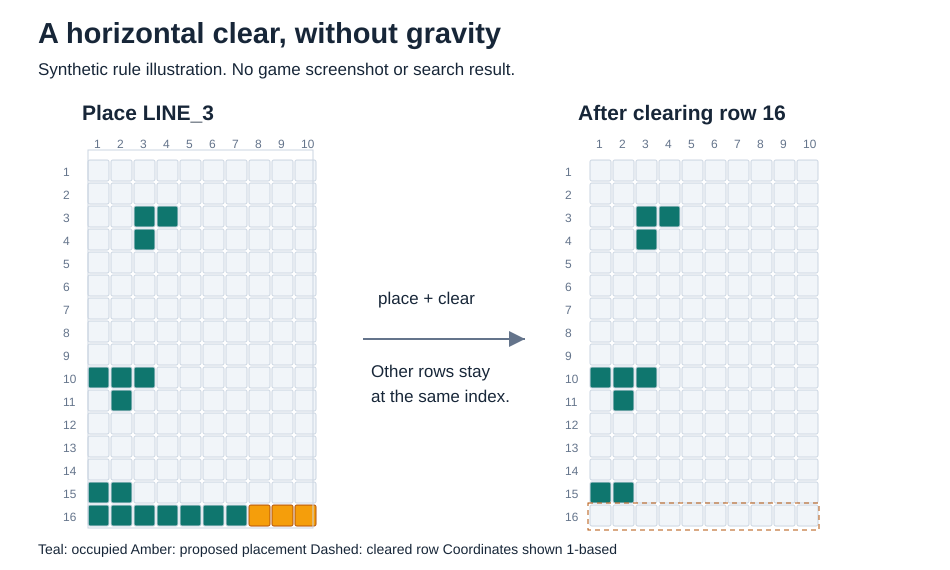
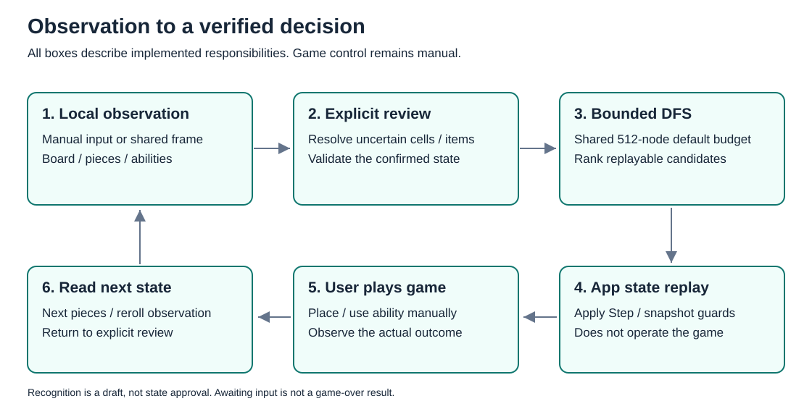
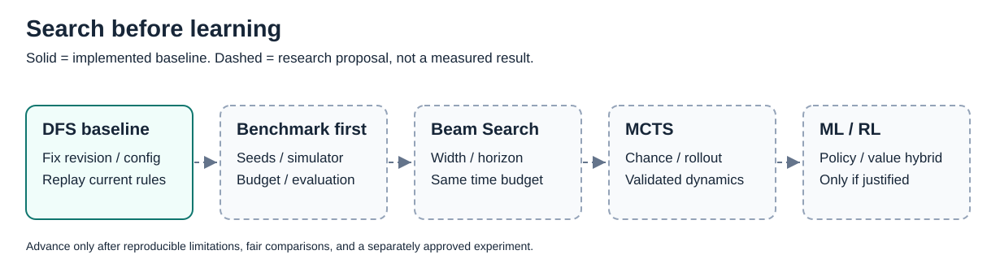
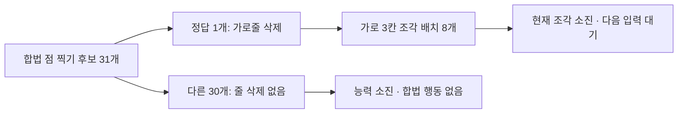

# Hangeul Decision Lab

### Budgeted Search and a Research Agenda for a Hangul Block Puzzle

**Implemented:** DFS assistant, synthetic simulator/benchmark, offline CPU CNN experiments, spatial residual contrast and frozen ranking diagnostics · **Application policy:** DFS · **RL:** FUTURE

## Abstract

Hangeul Decision Lab은 메이플스토리 한글날 이벤트의 16행 × 10열 블록 퍼즐을 상태 공간 문제로 모델링하는 웹 도구다. 제한된 계산 예산 안에서 현재 조각과 특수 능력의 사용 순서를 추천한다.

현재 구현은 합법 배치 열거, 공통 게임 전이, lexicographic evaluation, 완료된 subtree의 재사용을 결합한 deterministic depth-first search (DFS)를 사용한다. 화면 입력은 로컬 캡처와 판별을 거쳐 사용자가 명시적으로 확인한다. 실제 게임 조작은 사용자가 수행한다.

장기 연구 질문은 **같은 의사결정 시간 안에서 탐색과 학습이 장기 생존 및 줄 삭제를 얼마나 개선할 수 있는가**이다. 현재 seeded simulator를 통한 DFS 비교와 오프라인 CPU CNN의 supervised imitation pilot을 구현했다.

초기 합성 pilot에서 CNN의 teacher 선택 일치율은 53.3%로, first-legal baseline의 64.4%보다 낮았다. 이후 paired teacher 비교와 train/dev 오류 분석을 거쳐, 행동 직후 결과 22개를 추가한 고정 대조 실험을 수행했다. 확장 모델의 dev top1은 기존 모델과 같은 **29/89 (32.6%)**였으며, 점 찍기 정답은 **0/13**이었다. 사전에 정한 개선 gate를 통과하지 못했다.

후속 readonly 분석에서 dev 점 찍기 실패 13개는 다른 행동 종류를 고른 8개와 같은 종류의 다른 좌표를 고른 5개로 나뉘었다. 저장된 동점 대안의 첫 행동에 포함된 실패는 1개였다. Hard label과 점수는 변경하지 않았다.

이후 네 objective의 저장 결과를 대조했다. Dev 점 찍기 정답은 모두 0/13이었고, 선택된 checkpoint의 **train 점 찍기 정답도 control/combined/point-only/kind-only 순서로 0/2/1/1건, 분모는 52건**이었다. 점 찍기만 합법인 train 9건은 네 모델 모두 좌표 정답이 없었다. 현재 근거는 fitting 진단을 다음 연구 우선순위로 삼을 이유이며, 실패 원인을 모델 용량이나 최적화 중 하나로 확정하지 않는다.

실제 게임 화면에 접근할 수 없는 상태에서도 연구를 이어가기 위해, 점 찍기로 막힌 조각을 해금하는 **160개 좌표의 통제 시뮬레이션**을 추가했다. 이 작은 현재 턴 문제에서 DFS128/512는 완전 열거 reference와 160/160 일치했다. 기존 CNN은 이 실험에서 실행하지 않았으며, 합성 결과를 실제 게임·모델 fitting·장기 생존 성능으로 확대하지 않는다.

후속 통제 fitting 진단에서 같은 spatial CNN을 보드 16개에 200회 update했다. 정답은 1/16에서 15/16으로 늘었지만 평균 NLL 2.508과 음수 target margin으로 사전 fitting gate를 통과하지 못했다. 고정 예산을 한 번 사용했으며 추가 학습이나 튜닝은 하지 않았다.

5.12–5.32는 각 실험의 방법·결과·한계를 구분한다. 학습 절차와 재현성은 검증했지만 앱의 learned policy 채택이나 생존 향상을 뒷받침하지 않는다. Reinforcement learning (RL)은 향후 연구로 남는다.

**Keywords:** combinatorial planning, bounded DFS, legal-action masking, stochastic planning, reinforcement learning

## 1. Motivation and Research Questions

줄 삭제를 많이 만드는 선택이 다음 조각을 놓기 좋은 상태를 보장하지는 않는다. 조각 순서·회전·반전·아이템·능력과 미래 입력의 불확실성을 함께 고려해야 한다.

현재 구현의 기여는 UI와 분리된 전이/솔버, 예산과 후보 제한을 드러내는 탐색, 추천의 단계별 재생, 인식 결과의 명시 검토 및 공유 세션의 턴 연결이다. 아래 질문들은 **향후 비교 연구**다.

- **RQ1 — Budget:** 예산 확대로 놓친 유효 경로를 찾을 수 있는가?
- **RQ2 — Evaluation:** 후보 순서·가지 제거·평가 편향 중 무엇이 선택을 제한하는가?
- **RQ3 — Uncertainty:** 미래 조각/재뽑기 샘플링이 같은 시간의 결정적 탐색보다 유리한가?
- **RQ4 — Learning:** 앞선 개선 후에도 남는 한계를 학습한 policy/value가 추가 비용을 감수할 만큼 해결하는가?

## 2. Problem Formulation

$$s=(B,P,I,A,r)$$

| 기호 | 현재 의사결정 상태                           |
| ---- | -------------------------------------------- |
| $B$  | 16 × 10 Boolean 점유 보드                    |
| $P$  | 남은 최대 3개 조각의 instance·화면 slot·형상 |
| $I$  | 미획득 아이템의 좌표/종류, 보드 위 최대 3개  |
| $A$  | 점 찍기/바꿔 뽑기 횟수, 보유 합계 최대 7개   |
| $r$  | 재뽑기 결과를 기다리는 대상 또는 null        |

action은 조각 배치, 빈칸 한 곳에 점 찍기, 남은 조각 재뽑기다. 조각 사용 순서는 자유롭고, slot은 화면 위치 식별자다. 회전과 반전의 중복 variant를 제거하고 실제 `true`인 셀만 경계·충돌 검사에 사용한다.

가로줄은 동시에 삭제되며 중력은 없다. 능력을 소모한 뒤 삭제 행의 아이템을 행·열 순으로 획득한다. 보유 상한 때문에 획득하지 못한 아이콘은 같은 좌표에 남긴다.

19종 조각의 형상과 한글 이름은 제공된 자료를 기반으로 한다. ㄹ과 ㅌ은 각각 8칸이며, 점·ㅡ·ㅣ는 각각 1·3·5칸이다.

전체 형상과 규칙의 독립적인 실전 대조, 새 아이콘 생성 규칙, 단계별 출현 확률은 아직 확인을 마치지 않았다. 이벤트 배경은 [공식 안내][1]를 참고한다.



_Figure 1. 합성 규칙 예제. 마지막 행의 빈 3칸에 ㅡ를 배치하면 그 행만 비워지고 위의 셀은 제자리에 남는다. 게임 캡처·솔버 추천·성능 실험 결과가 아니다._

## 3. Implemented Method

### 3.1 Bounded DFS

기본값은 `maxNodes=512`, `maxAlternatives=3` (최선 포함), `useMemoization=true`다.

ordinary-only probe는 전체 예산의 최대 1/4을 사용한다. 실제 방문한 노드 수를 능력 DFS의 예산에서 차감하며, root를 포함한 합산 방문 수를 제한한다. 일반 조각 소진까지의 깊이는 최대 남은 3개 조각에 해당한다. 능력 사용과 재획득을 포함한 action 깊이는 3으로 고정되지 않는다.

```text
probe := ordinary-only DFS using part of the node budget
seed candidates with suitable terminal paths from the probe
DFS(state):
    stop and evaluate when awaiting next pieces or reroll input
    reuse only completed subtrees with the same search key
    enumerate configured ordinary and ability candidates
    apply actions through the shared domain transition
    stop at the node limit and mark the search incomplete
    rank evaluated candidates; retain up to three results
```

search key에는 점유 상태, 남은 조각의 instance와 형상, 아이템, 능력, pending 상태, 누적 삭제·획득 수가 포함된다.

예산 때문에 중단된 subtree는 memoization에 저장하지 않는다. 완료된 subtree의 결과를 재사용하므로, 반환한 alternatives와 path count를 모든 고유 경로의 열거로 해석할 수는 없다.

### 3.2 Evaluation and Ability Candidates

평가는 다음 우선순위를 따른다. 앞선 항목이 같을 때만 다음 항목을 비교하는 **lexicographic comparison**이다.

gameover 회피 → 현재 조각 소진 → catalog의 배치 가능 종류·배치 수 → 삭제 행 → 아이템 획득 → 능력 잔여 → 적은 고립·coverage gap → 많은 빈칸.

이 평가는 현재 규칙에 따른 순서 비교이며, 학습한 weighted reward는 아니다.

점 찍기는 모든 합법 빈칸을 후보로 두고, 즉시 행을 삭제하는 action부터 탐색한다. 재뽑기는 막힌 조각이 있거나, 초기 probe에서 소진 경로를 찾지 못했거나, catalog에서 배치 가능한 종류가 0개일 때 제한적으로 추가한다.

미완료 probe에서 경로를 찾지 못한 것만으로 배치가 불가능하다고 결론 내리지 않는다. 전체 domain의 legal-action mask와 solver가 탐색하는 제한된 후보를 구별한다.

mobility는 catalog에서 배치 가능한 조각 종류와 배치 수다. 미래 생존이나 출현 확률을 뜻하지 않는다. coverage gap은 빈 셀을 덮을 수 있는지를 나타내는 지표이며, 점 조각 때문에 gap이 0이어도 큰 조각의 소진을 보장하지 않는다.

재뽑기 결과는 실제로 다른 조각을 관측한 뒤 입력받는다. 현재 탐색은 그 입력을 기다리는 pending 상태에서 멈춘다.



_Figure 2. 구현된 입력–검토–탐색–재생 경계. 판별기는 초안을 만들고 사용자가 확인한 뒤 GameState에 반영한다. Apply Step은 앱 상태 재생이며 실제 게임 배치는 사용자 조작이다._

### 3.3 Observation and Review

선택한 화면 공유의 한 frame에서 보드 점유, 보유 조각 도형, 능력 숫자를 로컬에서 판별한다. 미확정 칸은 캡처 위에서 바로 수정할 수 있다. 아이템의 위치와 종류는 점유 상태와 별도로 검토하며, 초안을 자동 승인하지 않는다.

같은 공유 세션에서는 영역과 직전 확인 상태를 이어서 사용한다. 마지막 정상 Apply 뒤에는 제한된 자동 재읽기로 새 조각을 기다린다. 이전 상태와의 차이와 새 아이콘은 사용자가 명시적으로 확인한다.

캡처/임시 픽셀은 제한된 탭 메모리 수명 뒤 폐기한다. 저장·업로드·계정 연동·게임 자동 조작 기능은 없다.

## 4. Validation Scope and Limitations

검사는 합성 보드, 독립 좌표 oracle, 전이 replay, 예산과 memoization, 입력 수명, 브라우저 여정을 다룬다. 작은 fixture의 완전 비교는 해당 범위의 correctness 근거이며 전체 게임의 oracle는 아니다. `optimalWithinScope`는 설정한 후보와 평가 범위에 한정된다.

실제 게임의 연속 턴, 전체 형상·숫자·배율의 인식 정확도, 신규 아이콘과 출현 확률, 사용감과 별도 제품 수락은 미완료다.

짧은 합성 episode의 관측은 다음 절에 제시한다. 이를 실제 게임의 장기 생존, 알고리즘 승률, learning curve의 증거로 확대하지 않는다.

## 5. Synthetic Benchmark and Future Research

### 5.1 Benchmark First

실제 게임 플레이 없이 기존 domain 전이를 재사용하는 headless simulator를 실행할 수 있다. 합성 환경은 19종 조각에 동등 가중치를 주고, 재뽑기에서 현재 종류를 제외하며, 초기 아이템만 사용한다.

실제 출현 확률, 새 아이콘 생성, 7수 카운터는 모델링하지 않는다. 실제 게임과의 일치 여부는 별도 검증 과제로 유지한다. 5.4의 오프라인 imitation learning도 이 합성 환경만 사용한다.

초기 상태, catalog와 rules version, 다음 조각·재뽑기·아이콘 과정, seed와 PRNG, 종료 조건과 horizon을 고정한다. 환경, policy, rollout, 학습의 난수를 분리하고 action별 난수 소비 차이를 통제한다. 미래 tape는 policy에 노출하지 않는다.

다음 입력 대기, 실제 gameover, 시간 또는 episode truncation을 구별한다. 임의의 균등분포를 실제 출현 확률로 가정하지 않는다.

| Metric                      | 비교 정의                                                    |
| --------------------------- | ------------------------------------------------------------ |
| Survival / terminal step    | 소진 세트와 일반/능력 action 수, gameover/truncation 분리    |
| Clears / acquired items     | 누적 삭제 행/실제 획득, 잔류 아이템 제외                     |
| Ability usage               | 종류별 소모·재획득·잔여/구제 결과                            |
| Decision latency            | 합법 후보/평가/탐색/추론의 mean/p95, load/warmup 분리        |
| Search cost / memory        | 알고리즘별 nodes/simulations/memo, 정의한 heap/RSS/피크 한계 |
| Reference / reproducibility | 유효 경로 도달률, action/state hash, 오류/timeout/분산       |

같은 초기 상태, paired seeds, 종료 조건과 시간 상한으로 비교한다. 알고리즘 간 node count를 동일 비용으로 취급하지 않는다. train/dev/test는 seed와 episode 단위로 분리하며, 계열 밖 generalization은 별도 실험이 필요하다.

아래 작은 CNN pilot은 sparse/pressure 계열을 모든 split에서 공유한다. test benchmark로 학습하거나 tuning하지 않는다. 생존·삭제 성과, 지연·메모리, 안정성을 구분해 보고한다.

**실행된 pilot — 2026-10-07.** seed 17·42·2026 × sparse/pressure 보드의 6개 dev fixture를 사용했다. 예산 128/512, memoization 사용, alternatives 3개, 최대 12개 action으로 각각 2번 실행했다.

총 24개 episode이며, 반복을 독립 표본으로 세지 않는다. 실행 순서는 회전했고 별도 seed 0의 warmup은 집계에서 제외했다. 모든 episode의 replay와 반복 trace 일치 검사를 통과했다.

| 관측                           |   DFS 128 |    DFS 512 |
| ------------------------------ | --------: | ---------: |
| 평균 수행 행동 / 최대 12       |      7.67 |       8.00 |
| 평균 삭제 행                   |      0.83 |       1.00 |
| 평균 판단 시간                 |  395.79ms | 1,400.62ms |
| 판단 시간 p95                  |  596.17ms | 2,254.72ms |
| 불완전 탐색 / 판단 횟수        |   86 / 94 |    72 / 96 |
| gameover / horizon / 정책 포기 | 4 / 6 / 2 |  6 / 6 / 0 |

측정 환경은 Windows 10, i5-9400F, Node 24.15.0, 단일 worker다. 판단 시간은 `solveTurn` 호출부터 반환까지다. simulator의 legal-action 생성, 환경 공급, replay, 모듈 로드는 제외한다.

p95는 유효 episode의 판단 표본에서 nearest-rank로 계산한다. 보드마다 action 경로가 달라 두 설정의 판단 표본 수는 다르다. 이 비교는 **동일 시간 예산 실험이 아니다**.

전후 Node heap은 약 43.87 → 108.68 MiB, RSS는 226.77 → 358.22 MiB였다. compiler와 누적 기록을 포함한 전체 프로세스 관측이며, 순간 peak나 브라우저 메모리 기준을 뜻하지 않는다.

6개 paired fixture 중 pressure-42에서만 DFS 512가 action 2개를 더 수행하고 1행을 더 지웠다. 그 외 합산 action 수와 삭제 행 수는 같았다. sparse 3개는 모두 horizon에 도달했고, 아이템 획득은 전부 0이었다. 장기 생존, 아이템 전략, 학습 효과를 판정하기에는 표본이 부족하다.

policy abstention은 legal action이 남아 있는데도 policy가 action을 반환하지 않은 경우이며, gameover와 구분한다. 관측값, protocol, source·trace hash는 [pilot summary](assets/research/pilot-budget-20261007-v1.json)에 있다. CLI는 전체 fixture, tape, action, state 기록을 로컬 JSON으로 생성한다.

### 5.2 Search Before Learning



그림의 policy/value hybrid·RL은 조건부 후속이다. 별도로 실행한 CPU CNN 모방 feasibility는 5.4에 기록하며, 이 그림은 측정 chart가 아니다.

_Figure 3. DFS와 합성 benchmark 기반은 구현되어 있다. 점선 방법은 향후 비교안이며, 반복 가능한 한계와 비용 대비 개선 근거에 따라 선택한다. 도식 자체는 측정 결과가 아니다._

1. **Baseline / budget:** revision/config·probe·memo·평가를 고정하고 예산 곡선을 만든다.
2. **Pruning / evaluation:** 작은 완전 reference로 잘못된 제거를 검출하고 후보 순서·평가를 ablation한다.
3. **Beam Search:** width/depth·중복 제거·미래 sampling·cutoff 평가를 같은 시간의 DFS와 비교한다.
4. **MCTS:** 검증된 확률 모델에서 selection → expansion → rollout → evaluation → backpropagation을 검토한다. rollout 정책/깊이/수·chance 전이·재사용·변동성을 기록한다. UCT[2]는 개념 참고이며 본 게임 효용의 증거가 아니다.
5. **Conditional ML/RL:** 앞선 개선 후 유의미한 잔여 한계가 있고 학습/추론 예산과 별도 승인이 있을 때만 검토한다.

### 5.3 Conditional Policy / Value Learning

점유·아이템 plane과 조각·능력 입력을 사용하는 소형 CNN candidate scorer를 오프라인 imitation pilot에 구현했다. 앱에 채택된 learned policy나 value model은 없다. RNN, GNN, policy/value hybrid는 측정 가능한 이점이 있을 때 검토한다.

DQN[3], Actor-Critic/PPO[4], policy-guided search, learned value + MCTS는 후보 방법이다. 합법성은 기존 domain mask와 최종 전이 검증이 맡는다.

학습 자료는 승인된 simulator에서 생성한 episode다. 상대방과 대전하는 self-play로 설명하지 않는다.

reward 후보는 생존·삭제·획득과 mobility, 능력 잔여, 고립, 불필요한 소모에 대한 reward shaping이다. 가중치와 terminal penalty는 미정이며, proxy bias는 ablation으로 검사한다.

모델은 action ordering과 leaf value를 보완하는 hybrid로도 비교한다. 개선이 작거나 지연·메모리·복잡도·불안정성이 크면 deterministic search를 유지한다.

기록은 문제 → 가설 → fixture/seed/config → 관찰 → 해석 → 결정으로 연결하고 실패/기각도 보존한다. chart는 CSV/JSON 원본·생성 방법을 필요로 하며 개념 그림을 측정 결과처럼 사용하지 않는다.

### 5.4 Technology Briefing

| 역할                      | 현재 채택                                        | 다음 제안                                            |
| ------------------------- | ------------------------------------------------ | ---------------------------------------------------- |
| 게임 규칙·탐색·시뮬레이션 | TypeScript / Node.js, pure domain, 예산 제한 DFS | 현재 전이를 학습 자료 생성·합법 행동 검증에도 재사용 |
| 화면 입력·검토            | React / Next.js, 브라우저 Canvas의 로컬 판별     | 이번 CNN 실험에서 변경 없음                          |
| 신경망 학습               | 연구 전용 Python 3.13.13 / PyTorch 2.14.1+cpu    | 소형 CNN pilot과 paired teacher 실험 완료            |
| 학습 목표                 | 합성 상태의 bounded DFS hard-label imitation     | 장기 생존·RL은 별도 후속 연구                        |

PyTorch의 [공식 학습 경로](https://docs.pytorch.org/tutorials/beginner/basics/quickstart_tutorial.html)를 참고해 연구 전용 CPU 실행을 채택했다.

모델은 보드의 3개 input plane에 3 × 3 convolution (채널 8/8)과 4 × 5 pooling을 적용한다. 조각·능력 metadata 140개 값과 legal candidate feature 52개 값을 32차원 embedding에서 함께 점수화한다. 총 12,189개 parameter를 사용하며, 전체 domain의 legal candidate에만 softmax를 적용한다.

미래 조각, seed, instance 이름, teacher 결과는 forward 입력에서 제외한다. 아래 초기 pilot은 DFS 512를 teacher로 사용하며, 5.12의 paired 실험은 DFS 512와 1024를 비교한다. 두 bounded teacher의 선택은 최적 정답이 아니다. 각 선택의 search scope와 incomplete 여부를 함께 보관한다.

**실행된 CNN pilot — 2026-10-08.** seed 범위는 train 1000–1015, dev 2000–2003, test 3000–3003이다. 각 seed에 sparse/pressure를 적용하고 horizon을 6으로 고정했다. 총 48개 episode에서 train/dev/test 각각 168/45/45개 선택을 얻었다.

teacher의 202/258개 선택은 incomplete search에서 나왔다. skip과 error는 0건이었으며, 모든 episode, encoding, key를 domain에 대조했다.

학습 설정은 Adam (learning rate 0.001, weight decay 0.0001), batch size 8, 12 epochs, seed 20261008, CPU 2 threads다. dev top1이 가장 높은 첫 checkpoint (epoch 11, 40.0%)를 선택한 뒤 test를 평가했다.

같은 train/dev 재실행에서 전체 loss, checkpoint 선택, weights가 bit-equal이었다. 이 재현 검사에는 test 점수를 사용하지 않았다.

| 시험 관측                                | 결과                                      |
| ---------------------------------------- | ----------------------------------------- |
| CNN top1 / first-legal baseline          | 24/45 (53.3%) / 29/45 (64.4%)             |
| fixture macro top1                       | 54.2%, 독립 test fixture 8개              |
| teacher complete / incomplete의 CNN 일치 | 8/13 (61.5%) / 16/32 (50.0%)              |
| 최종 domain 적용                         | 45/45 합법, NaN 0건·반복 예측 일치        |
| CPU 추론 mean / p95                      | 0.56 / 0.92 ms, 45개 선택 × 고정 3회 반복 |
| tensor 생성 → 선택 key mean / p95        | 1.99 / 4.68 ms, 45개 선택                 |
| 학습+dev / 연구 runner 처리 시간         | 3.67 / 7.28초                             |
| process working set 전후                 | 183.9 / 349.7 MiB, 순간 peak 제외         |

Windows 10 / i5-9400F 개발 PC에서 관측한 결과다. 추론 시간에는 finite 검사와 argmax를 포함하고 load와 warmup은 제외한다. domain 후보 생성, JSON 처리, 프로세스 시작, IPC, UI 시간은 포함하지 않는다. 연구 runner의 처리 시간도 Python/PyTorch import를 제외한다.

45개 연속 상태를 독립적인 45개 게임으로 세지 않는다. 계열 밖 generalization, 통계적 우월성, 실전 생존, RL은 검증하지 않았다. **first-legal baseline보다 낮아 현재 모델의 제품 적용을 추천하지 않는다.** 같은 가치의 다른 legal action도 hard-label top1에서는 불일치로 집계될 수 있으므로, 이 점수는 생존 성과를 뜻하지 않는다.

비민감 수치와 protocol·source·data hash는 [CNN pilot summary](assets/research/pilot-cnn-imitation-20261008-v1.json)에 있다. raw data와 checkpoint는 Git 밖 로컬에 보관한다. 설치 다운로드 외에 자료 전송은 없다.

### 5.5 Teacher Order and Coverage Audit

**진단 — 2026-10-08.** 재학습에 앞서 기존 자료의 분포와 teacher 선택을 검사했다. label이나 모델 성적을 보지 않고, train 1000–1003 / dev 2000–2003 × sparse/pressure의 최초 상태 16개를 고정했다.

각 상태에 원본, 조각 배열 뒤집기, slot 번호 순환 (0 → 1 → 2 → 0)을 적용해 DFS 512를 총 48회 실행했다. slot 변경은 보드, 조각 instance와 형상, 능력, 아이템, 전체 물리적 legal-action 집합을 보존한다. 게임에서 조각 선택 순서는 자유롭다.

| 진단 관측                            | 결과                           |
| ------------------------------------ | ------------------------------ |
| 배열만 뒤집은 대조                   | 16/16 경로·평가·탐색 정보 동일 |
| slot 순환 뒤 물리적 첫 행동 변경     | 14/16 상태                     |
| 선택 경로의 lexicographic evaluation | 향상 7 / 저하 7 / 동일 2       |
| 변경된 첫 행동 중 경로 평가 동점     | 0/14                           |
| 원본 탐색 미완료                     | 16/16                          |
| 반환 경로의 domain 재생              | 144/144 통과                   |
| 모델 입력의 정확 중복                | split 내부·split 간 모두 0건   |

teacher는 후보를 slot 순서로 방문하고 제한된 탐색에서 찾은 경로를 반환한다. 위 관측은 **이 예산과 표본에서의 순서 민감성**을 보여준다. 서로 다른 첫 action을 같은 정답으로 합칠 수 있다는 증거나, CNN 성적 저하의 단독 원인은 아니다.

반환 결과 3개에서는 서로 다른 첫 action의 최상 동점이 관측되지 않았다. 그러나 memoization과 truncated search 때문에 전체 동점 후보가 없다고 증명할 수는 없다. 경로 평가의 동점도 즉시 action value나 미래 생존의 동일성을 뜻하지 않는다.

학습 자료에서 first-legal label의 비율은 전체 84/168 (50.0%), complete search 5/37 (13.5%), incomplete search 79/131 (60.3%)다. 배치 label의 124/131 (94.7%)는 남은 조각 중 가장 작은 slot을 선택했고, sparse에서는 89/89였다. 아이템 획득은 train/dev/test에서 각각 2/1/0회에 불과하다.

seed 분리와 정확한 관측 중복 0건만으로 계열 밖 generalization이나 충분한 전략 표본을 보장할 수 없다. 기존 test 통계는 설명용으로만 집계했으며, 새 test 탐색·tuning·점수 측정은 하지 않았다. 현재 CNN 결과와 앱 DFS는 유지한다.

분모, 계열별 수치, hash는 [진단 요약과 고정 protocol](assets/research/teacher-order-audit-20261008-v1.json)에 보관한다.

### 5.6 Complete Reference and Experiment Preflight

순서 진단 뒤 다음 비교 실험의 [제안 protocol](research/experiments/teacher-quality-v1.json)과 preflight 도구를 추가했다. train 4000–4003, dev 5000–5001, reserved test 6000–6003을 분리하고, 노드 예산 128/512, slot 대조, 반복 2회를 설계했다.

**이 preflight 당시 본 실험은 PROPOSED / NOT RUN이었다.** 제안 원본은 보존하며, 이후 train/dev 진단은 5.7에 별도로 기록한다. reserved test 생성과 새 모델 학습은 하지 않았다.

동일한 노드 수는 동일한 실행 시간을 뜻하지 않는다. 현재 동기 DFS에 실제 deadline이 생기기 전까지 시간은 관측값으로만 비교하도록 명시했다.

실행한 검사는 의도적으로 만든 합성 상태 7개를 사용한다. 연구 reference는 최대 2개 조각의 전체 ordinary placement 경로를 memoization과 pruning 없이 열거한다. domain 전이와 평가를 공유하므로 게임 규칙의 독립 oracle는 아니다.

노드 상한 1024에서 미완료이면 최적 첫 action 집합을 반환하지 않는다. 능력 사용은 별도로 지정한 전이를 검사하며, ordinary-only reference는 능력을 탐색하지 않는다.

| 실행 전 검사 관측 — 2026-10-08                      | 결과                         |
| --------------------------------------------------- | ---------------------------- |
| 완전 일반 reference                                 | 7/7, 총 903개 노드           |
| production ordinary DFS의 memo off/on 비교          | 14/14 최상 평가·첫 행동 일치 |
| 반환 경로의 domain 재생                             | 34/34                        |
| 직접 지정한 획득·상한 잔류·점 소모/획득·reroll 대기 | 4/4                          |
| 가장 큰 최상 첫 행동 집합                           | 22개                         |
| 새 reserved test 생성 / 학습 실행                   | 0 / 0                        |

완전한 작은 트리에서는 반환 결과 3개보다 많은 최상 첫 action을 확인할 수 있었다. 이는 **해당 ordinary-only 현재 턴의 경로 평가**에 한정된다. 3개 조각과 능력을 모두 탐색했을 때나 미래 생존에서도 같은 label로 취급할 수 있다는 증거는 아니다.

deliberate coverage 표본은 규칙을 검사하기 위한 예이며, 실제 빈도나 모델 효용을 나타내지 않는다. 기존 CNN top1과 앱의 DFS는 유지한다. 비민감 결과와 hash는 [preflight summary](assets/research/teacher-quality-preflight-20261008-v1.json)에 있다.

### 5.7 Train/Dev Order and Budget Diagnostics

위 제안의 새 train/dev seed × sparse/pressure에서 생성한 **12개 초기 상태**를 기존 `solveTurn`으로 진단했다. 노드 예산 128/512 × 순서 3가지 × 반복 2회로 **총 144회 호출**했으며, 반환 경로 **432개**를 domain으로 replay했다.

현재 조각 3개와 능력만 전달하고 future tape는 전달하지 않는다. memoization과 alternatives 3개를 유지했으며, 상태 index와 반복에 따라 6개 조건의 실행 순서를 회전했다.

반복한 72개 조건의 결과가 동일했고, 단순 배열 뒤집기 대조 24쌍도 동일했다. 반복은 독립 표본으로 세지 않는다.

| 현재 턴 관측, 독립 초기 상태 12개              | DFS 128   | DFS 512   |
| ---------------------------------------------- | --------- | --------- |
| slot 순환 후 첫 추천 변화                      | 10/12     | 10/12     |
| slot 순환 후 경로 평가 향상 / 저하 / 동일      | 7 / 3 / 2 | 5 / 6 / 1 |
| 기본 순서 탐색 미완료                          | 12/12     | 12/12     |
| 기본 순서 선택 경로 줄 삭제 합계               | 4         | 5         |
| 기본 순서 점 능력 사용 경로 / reroll 대기 경로 | 4 / 2     | 3 / 2     |
| 기본 순서 아이템 획득 / 상한 잔류              | 0 / 0     | 0 / 0     |

기본 순서에서 노드 예산을 128 → 512로 늘리면 공통 lexicographic evaluation이 **8/12 향상·4/12 동일**했고, 첫 추천은 2/12에서 바뀌었다. slot 순환 조건에서는 5/12 향상·7/12 동일이었다.

반복을 제외한 72개 상태·조건 조합의 탐색이 모두 incomplete였고, 획득·잔류 표본은 0이었다. 더 큰 예산이 순서 민감성을 해소하거나 아이템 전략을 충분히 대표한다고 볼 수 없다. 같은 경로 평가에서 첫 action이 달라진 1건도 장기 생존의 동등 정답을 뜻하지 않는다.

시간은 warmup 없이 측정했다. cold start, JIT, 개발 PC에서 동시에 실행한 테스트·정적 검사의 영향을 포함하는 관측값이다. 작은 집단의 p95를 속도 수락이나 동일 시간 비교로 사용하지 않는다.

보드 12개는 현재 합성 profile의 초기 상태이며, 장기 episode 분포나 실제 게임 확률을 대표하지 않는다. 새 test 평가, 추가 학습, 앱 policy 변경은 실행하지 않았다. 집단별 coverage와 시간, 고정 실행 설정, hash는 [matrix summary](assets/research/teacher-matrix-20261008-v1.json)에 있다.

### 5.8 Scripted Item and Capacity Coverage

초기 상태 진단에서 획득·상한 잔류가 0건이었던 한계를 점검하기 위해 **의도적으로 만든 8개 상태**를 별도로 실행했다. 검사한 상황은 다음과 같다.

- 일반 획득, 보유 상한 7에서의 미획득 잔류, 점 소모 후 획득, reroll 대기.
- 보유량 6에서의 획득 순서, 상한에서 점 소모 후 획득·초과 잔류.
- 5개 행의 동시 삭제에서 row/col 순으로 획득, 상한에서 reroll 소모 후 관측 대기.

이 상태들은 실제 이벤트 빈도나 학습 자료 분포를 나타내지 않는다.

| 검사                                               | 결과                     |
| -------------------------------------------------- | ------------------------ |
| 명시 정답 전이 / ordinary-only 완전 reference 대조 | 8/8 / 8/8                |
| 기존 full solver 호출 / 동일 반복조건              | 32 / 16/16               |
| 일반·능력 반환경로 domain 재생                     | 106/106                  |
| 선택 경로 획득 / 상한 잔류 발생, 각 예산 8개 상태  | 5/8 / 2/8 (128·512 모두) |
| 선택 경로 점 사용 / reroll 대기, 각 예산 8개 상태  | 6/8 / 1/8 (128·512 모두) |
| full 탐색 미완료, 128 / 512                        | 6/8 / 5/8                |

지정한 action의 기대 전이와 solver의 선택 결과를 분리했다. **규칙을 검사하는 상황을 만들었다는 사실만으로 solver가 그 action부터 선택해야 하는 것은 아니다.** scripted 첫 action과 추천이 일치한 상태는 각 예산에서 2/8이었으며, 목표는 그 일치율을 최대화하는 것이 아니다.

상한에서 점을 먼저 쓰면 보유 공간을 확보해 아이콘 하나를 획득하고, 초과 아이콘은 보드에 남는다. 아이콘 배열을 역순으로 넣어도 여러 행을 동시에 삭제할 때 row/col 순으로 획득했다.

tiny reference의 완전성은 ordinary-only의 공통 평가 범위에 한정된다. 능력 전체나 미래 최적성은 보장하지 않는다. 상황별 forced transition과 선택 결과, hash는 [coverage summary](assets/research/item-coverage-20261008-v1.json)에 보관한다. 새 학습, test 평가, 앱 의미 변경은 없다.

### 5.9 Permutation Union and Equal Node-Cap Comparison

기존 **generated 초기 상태 12개와 scripted 상태 8개**를 재사용해 slot 순서의 영향과 탐색량 증가의 영향을 분리했다. 현재 teacher와 모델을 변경하지 않는 diagnostic이다.

- **A:** 기존 slot 순서의 단일 DFS 512.
- **B:** 같은 순서의 단일 DFS 3072.
- **C:** 여섯 slot 순서에서 각각 DFS 512를 실행하고, 반환 경로를 원래 slot으로 복원한 합집합에서 선택.

B와 C의 총 노드 상한은 상태당 **3,072**로 같다. memo는 호출마다 새로 시작하며, 같은 상한이 같은 실행 시간이나 실제 탐색 비용을 뜻하지는 않는다.

| 현재 턴 경로 평가: 향상 / 저하 / 동일 | C vs A512 | C vs B3072 |
| ------------------------------------- | --------- | ---------- |
| generated 초기 상태 12개              | 8 / 0 / 4 | 5 / 6 / 1  |
| scripted 상태 8개                     | 0 / 0 / 8 | 0 / 0 / 8  |

**C는 A보다 나은 경로를 찾았지만, 같은 노드 상한의 B보다 우월하다는 근거는 얻지 못했다.** generated에서 C의 기본 순서 호출이 A를 포함하므로 C vs A의 저하 0은 구조적으로 기대한 결과다. C vs B의 저하 0·향상 1 이상이라는 pilot gate는 미충족이며, 기존 teacher label과 CNN은 유지한다.

반복·slot 순환·배열 대조를 포함해 measured **600호출**, 반환 경로 **1,740개**를 검사했다. 반복 100조건, 배열 대조 20쌍, C의 slot 순환 대조 20쌍이 일치했다. 과거 A512의 best/alternatives와 SearchInfo도 20/20 일치했다. 별도 warmup 8호출은 집계에서 제외했다.

generated의 A/B/C 선택 경로는 획득·상한 잔류가 모두 0이었다. scripted에서는 세 조건 모두 획득 발생 5/8·잔류 2/8·점 사용 6/8·reroll 대기 1/8이었다. 의도적 coverage 상태는 실제 빈도나 학습 분포를 대표하지 않는다.

generated B/C의 실제 visited nodes는 반복을 제외하면 각각 36,864였다. condition latency 평균은 B 약 7.02초, C 약 7.71초로 관측했다. 이 시간에는 변환·합법성 대조·solve·선택·replay가 포함되며 per-call 파일 기록 비용은 분리했다. warmup, GC/JIT, 표본 크기의 한계 때문에 앱 응답 시간 수락이나 동일 시간 비교로 해석하지 않는다.

measured 호출 중 **510/600은 incomplete**였다. 합집합은 반환된 경로만 사용하며 제한 reroll과 alternatives 누락 가능성을 유지한다. 현재 턴 평가의 동점은 미래 가치의 동등 label을 뜻하지 않는다. 추가 학습, 새 test 평가, 앱 policy 변경은 수행하지 않았다. 고정 설정·집단별 coverage/시간·hash는 [permutation summary](assets/research/permutation-teacher-20261008-v1.json)에 있다.

### 5.10 Canonical Piece Order Diagnostic

**도형 기준의 canonical 순서에서 단일 DFS 512를 실행하는 연구 진단**을 구현하고, 기존 20개 초기 상태에서 실행했다. 정렬 key는 variant orbit의 최솟값, 현재 shape, catalog ID, pending 상태다. instance ID와 이름은 정렬에 사용하지 않는다. 기존 shape와 solver의 best 선택 규칙은 유지하며 결과를 원래 조각에 복원한다.

기본 순서 A와 canonical 순서 D를 같은 512-node 예산에서 비교했다. D에는 여섯 slot 순서, 배열 반전, instance rename을 적용하고 2회 반복했다. warmup 2회는 집계에서 제외했다.

| 표본                          | D가 A보다 향상 | 저하 | 동일 |
| ----------------------------- | -------------: | ---: | ---: |
| Generated initial states (12) |              2 |    4 |    6 |
| Scripted states (8)           |              0 |    0 |    8 |

본 진단 **360회 호출**, **1,044개 반환 경로**의 raw·복원 replay를 통과했다. 같은 조건의 반복 180개와 canonical identity 대비 semantic full path·evaluation·final state의 invariance 280회도 통과했다. 기존 A의 20개 결과는 이전 진단과 정확히 같았다.

Pilot gate는 generated 저하 0개와 향상 1개 이상, 모든 invariance 통과를 요구한다. 이번 결과는 **미충족**이며 기존 teacher, label과 CNN을 유지한다. 이 고정 표본에서의 invariance를 임의 상태의 수학적 보장이나 미래 턴 가치 개선으로 해석하지 않는다.

Condition latency의 median은 A 약 1.26초, D 약 1.24초였다. 이는 generated·scripted와 두 반복을 합친 관측으로, key·매핑·합법성 대조·solve·복원·replay를 포함한다. 파일 기록 비용은 분리했다. 앱 응답 시간 수락이나 동일 wall-time 실험은 아니다.

본 진단의 **306/360 호출은 incomplete**였다. 반환 경로와 제한된 reroll만 평가하며 미래 최적성이나 teacher 채택을 보장하지 않는다. 새 학습 자료, held-out test와 추가 학습은 만들지 않았다. 고정 설정, 표본별 차이, coverage와 시간·hash는 [canonical summary](assets/research/canonical-teacher-20261010-v1.json)에 있다.

### 5.11 Search Budget and Root Cause

Canonical 결과가 낮았던 네 사례를 기존 20개 상태에서 추가로 분석했다. 기존 보고서의 522개 반환 경로를 재생했고, canonical 결과는 기존 여섯 순서 중 같은 permutation의 결과와 20/20 일치했다.

Passive trace를 포함한 **60회 호출·176개 반환 경로**를 검증했다. 반복 24조건과 trace를 켠 12회 결과도 기존 결과와 정확히 같았다. Solver의 탐색·평가 규칙은 유지했다.

세 저하 사례에서는 기존 최선 경로의 첫 수가 canonical 탐색의 93·419·150번째 후보로 밀렸고, 512-node 예산에서 방문되지 않았다. 나머지 한 사례는 첫 수를 방문했지만 예산 종료 때 다른 깊이의 frontier를 평가해 기존 경로가 후보에 포함되지 않았다. Canonical 예산을 3,072로 늘려도 앞 세 사례는 기존 DFS512보다 낮았다.

기존 결과를 유지하는 portfolio는 A512와 D512 중 평가가 더 좋은 결과를 고르고, 동점이면 A를 유지한다. 이 후보와 단일 A1024를 같은 **총노드 상한 1,024**에서 비교했다.

| 비교               | Generated 12: 향상 / 저하 / 동일 | Scripted 8 |
| ------------------ | -------------------------------- | ---------- |
| Portfolio vs A512  | 2 / 0 / 10                       | 모두 동일  |
| A1024 vs A512      | 4 / 0 / 8                        | 모두 동일  |
| Portfolio vs A1024 | 2 / 4 / 6                        | 모두 동일  |

Portfolio는 유지한 A512 대비 현재 평가 저하를 막지만 A1024와의 우열은 섞였다. 같은 wall time이나 미래 턴 가치를 비교한 결과는 아니다. 노드 예산을 늘리면 ordinary probe와 reroll 조건도 달라질 수 있어 탐색 후보의 포함 관계를 가정하지 않는다.

**평가가 향상된 A1024의 네 사례 중 첫 행동 변경은 두 사례였다.** 전체 경로 평가 개선과 single hard label 개선을 구분해야 한다. 이 관측을 바탕으로 같은 입력의 DFS512/1024 label과 CNN을 비교하는 별도 고정 실험을 실행했다. 결과는 5.12에 기록하며 앱 모델 적용은 하지 않았다.

60회 중 54회는 incomplete였다. 고정 초기 상태의 관측이며 teacher 채택이나 장기 정책 개선을 보장하지 않는다. 입력·source·파생 trace hash와 표본별 결과는 [root cause summary](assets/research/teacher-root-cause-20261011-v1.json)에 있다.

### 5.12 Paired Teachers and Frozen CNN Comparison

**실행 — 2026-10-11.** 같은 A512 rollout 관측에 A512와 A1024가 각각 label을 부여했다. train 8000–8031, dev 9000–9007, test 6000–6003에 sparse/pressure를 적용하고 horizon을 6으로 고정했다. train/dev/test의 kept 관측은 **339/89/44개**다. Cross-split forward·semantic 중복은 0건이며 내부 중복 0건과 paired abstention 2건은 기록 후 제외했다.

두 CNN은 같은 구조·입력·초기 weights·sample order로 각각 12 epoch 학습했다. Label만 다르며 own-teacher dev top1 최고값의 최초 epoch를 선택했다. A512는 epoch 11, A1024는 epoch 12였다. **두 checkpoint와 source·protocol·data hash를 모두 고정한 뒤 reserved test를 처음 생성했다.** Test 점수에 따른 재선택이나 추가 학습은 하지 않았다.

| Split | 관측 | A1024 평가: 향상 / 저하 / 동일 | 첫 label 변경 | Incomplete A512 / A1024 |
| ----- | ---- | ------------------------------ | ------------- | ----------------------- |
| train | 339  | 35 / 2 / 302                   | 22            | 254 / 243               |
| dev   | 89   | 20 / 0 / 69                    | 12            | 66 / 64                 |
| test  | 44   | 1 / 0 / 43                     | 1             | 33 / 31                 |

Train 관측 중 2개는 A1024의 반환 평가가 더 낮았다. 더 큰 node budget에서 평가가 항상 좋아진다고 가정하지 않는다. 경로 평가 개선과 첫 행동 label 변화도 구분한다. 같은 test 관측에서 두 모델을 두 teacher label 모두에 대조했다.

| 예측        | A512 label top1 | A1024 label top1 |
| ----------- | --------------- | ---------------- |
| CNN-A512    | 19/44 (43.2%)   | 19/44 (43.2%)    |
| CNN-A1024   | 19/44 (43.2%)   | 19/44 (43.2%)    |
| first-legal | 24/44 (54.5%)   | 24/44 (54.5%)    |

같은 8개 초기 상태와 미래 조각 tape에서 각 policy를 최대 6 action 진행했다. 미래 tape는 환경에만 있으며 solver/model 입력에는 없다. 모든 40개 rollout과 CNN의 각 행동을 기존 domain으로 검증했다.

| Policy      | Actions | Cleared rows | Acquired / retained items | Single-cell / reroll uses | Horizon / gameover / abstention |
| ----------- | ------- | ------------ | ------------------------- | ------------------------- | ------------------------------- |
| A512        | 45      | 9            | 0 / 0                     | 6 / 2                     | 7 / 1 / 0                       |
| A1024       | 42      | 9            | 0 / 0                     | 5 / 1                     | 7 / 0 / 1                       |
| first-legal | 42      | 1            | 0 / 0                     | 4 / 4                     | 5 / 3 / 0                       |
| CNN-A512    | 41      | 3            | 0 / 0                     | 3 / 4                     | 5 / 3 / 0                       |
| CNN-A1024   | 41      | 3            | 0 / 0                     | 3 / 4                     | 5 / 3 / 0                       |

두 CNN의 test 예측은 44/44개에서 같았고, rollout의 행동과 결과도 8/8개 episode에서 같았다. Teacher 예산 확대로 이번 CNN의 예측이나 rollout이 개선되지는 않았다. 두 CNN은 first-legal보다 top1이 낮았으며 삭제 행 합계는 CNN 3행, first-legal 1행, 각 DFS 9행이었다.

Top1은 해당 bounded teacher와의 일치율이며 최적 행동의 정확도가 아니다. 8개 test episode와 6 action horizon으로 장기 생존이나 policy 우월성을 주장하지 않는다. 같은 episode의 관측은 독립적이지 않고 sparse/pressure 두 family를 모든 split에서 공유한다. Split/family별 도형·능력·획득/잔류·pending coverage와 episode별 결과는 [paired experiment summary](assets/research/paired-teacher-cnn-20261011-v1.json)에 있다. Test의 아이템 획득·상한 잔류는 모두 0건이었다. 두 family 각각 test에 나타난 도형은 19종 중 17종이었다. Coverage가 0인 기능의 개선을 추정하지 않는다.

실제 visited nodes는 622,511개, policy 결정은 211개였고 전체 실행은 27.76분이었다. 실행 환경은 Windows, Intel Core i5-9400F(6 cores), RAM 약 32 GiB, 기존 CPU PyTorch 2.14.1이다. 시간과 전후 memory는 해당 PC의 관측값이며 peak memory·동일 wall-time 우열을 측정한 결과가 아니다. 기존 pilot 자료·checkpoint와 앱 DFS는 유지하고 이번 두 모델도 offline 연구에만 사용한다. 각 teacher당 한 번, 공통 seed 한 개로 학습했으므로 학습 seed 변동성은 평가하지 않았다. 새 runtime·dependency·service·RL은 도입하지 않았다.

### 5.13 Frozen Train/Dev Error Analysis

**실행 — 2026-10-11.** 5.12에서 고정한 두 checkpoint를 기존 train 339개와 dev 89개 관측에 대조했다. 학습·teacher 호출·test 재평가는 하지 않았다. 동일 입력의 logits를 반복해 정확한 일치를 확인하고, 행동 종류·도형·family·후보 수·teacher 탐색 완료 여부별로 분모를 함께 기록했다.

| Split | 모델  | Own-teacher top1 | First-legal top1 | Top5  | NLL / uniform NLL |
| ----- | ----- | ---------------- | ---------------- | ----- | ----------------- |
| train | A512  | 123/339 (36.3%)  | 52.5%            | 59.6% | 3.871 / 5.075     |
| train | A1024 | 123/339 (36.3%)  | 49.6%            | 57.8% | 3.870 / 5.075     |
| dev   | A512  | 29/89 (32.6%)    | 52.8%            | 52.8% | 3.812 / 4.988     |
| dev   | A1024 | 26/89 (29.2%)    | 48.3%            | 52.8% | 3.818 / 4.988     |

두 모델 모두 teacher가 점 찍기를 선택한 train **52개**와 dev **13개**에서 top1이 0이었다. 두 모델의 weights는 서로 다르지만, 예측은 train 314/339개와 dev 86/89개에서 같았다. 같은 checkpoint를 잘못 읽었다는 설명과는 맞지 않는다.

Train에서도 낮은 top1이 나타나므로 test 일반화 문제만으로 설명하기 어렵다. 전체 NLL은 uniform보다 낮아 아무것도 학습하지 않았다고 단정할 수도 없다. 입력 표현·최적화·label noise 중 어떤 요인이 원인인지는 아직 확정하지 못했다.

전체 그룹 집계와 모델·자료 hash는 [diagnostic summary](assets/research/frozen-train-dev-diagnostic-20261011-v1.json)에 있다. 작은 합성 표본의 모방 정확도이며 정책 가치나 생존 성능이 아니다.

### 5.14 Fixed Action-Outcome Feature Contrast

**실행 — 2026-10-12.** 행동별 즉시 결과를 직접 제공하면 점 찍기 모방이 나아질 수 있다는 가설을 검토했다. 기존 A512 label과 train 339개 / dev 89개 관측을 그대로 사용했다. 후보 순서·전체 합법 mask·관측·metadata도 유지했다.

기존 52개 candidate feature 뒤에 다음 22개를 붙여 별도 74개 입력을 만들었다. 기존 앱과 모델의 입력 계약은 유지했다.

| 추가 입력                           | 개수 | 정규화    |
| ----------------------------------- | ---- | --------- |
| 삭제한 행 수                        | 1    | / 16      |
| 획득한 점 찍기·reroll 아이템 수     | 2    | 각각 / 3  |
| 상한 때문에 획득하지 못한 아이템 수 | 1    | / 3       |
| 행동 후 점유 칸 수                  | 1    | / 160     |
| 행동 후 pending reroll 여부         | 1    | 0 또는 1  |
| 행동 후 각 행의 점유 칸 수          | 16   | 각각 / 10 |

기존 TS domain의 `applyAction`을 현재 합법 후보마다 한 번 호출했다. 전체 **149,597개 후보**의 즉시 결과만 계산했으며, 새 DFS 탐색·episode·label은 만들지 않았다. Reroll은 pending 상태에서 멈췄다. 미래 조각·reroll 결과·teacher 경로·reward·정답은 model feature에 넣지 않았다.

Baseline52와 outcome74를 동일 CPU 환경에서 각각 **12 epoch** 학습했다. Seed·batch·optimizer·loss·shuffle을 고정하고 각 모델의 A512 dev top1이 가장 높은 최초 epoch를 선택했다. 추가 22개 입력의 weights는 0으로 시작했다. 기존 52개 입력의 선형 계산을 유지하는 별도 branch를 합쳐, 학습 전 **428개 관측의 initial logits가 정확히 같음**을 확인했다. Parameter 수는 12,189 → 12,915개다.

Baseline은 원본의 전체 epoch 기록·선택 epoch·weights를 정확히 재현했고, checkpoint byte hash도 같았다. 이 대조를 통과한 뒤에만 outcome 학습을 시작했다.

| 지표                   | Baseline52          | Outcome74           |
| ---------------------- | ------------------- | ------------------- |
| 선택 epoch             | 11                  | 12                  |
| Train top1             | 123/339 (36.3%)     | 123/339 (36.3%)     |
| Dev top1               | 29/89 (32.6%)       | 29/89 (32.6%)       |
| Dev top5               | 47/89 (52.8%)       | 55/89 (61.8%)       |
| Dev NLL                | 3.812               | 3.534               |
| Dev fixture macro top1 | 32.3% / 16 fixtures | 32.3% / 16 fixtures |
| Dev 점 찍기 top1       | 0/13                | 0/13                |
| Dev reroll top1        | 7/8                 | 8/8                 |

First-legal dev top1은 47/89 (52.8%)였다. NLL은 자연로그이며 같은 후보 목록의 uniform NLL은 4.988이다. Top5와 NLL 변화가 top1 선택 개선을 뜻하지는 않는다.

| 사전 gate — 모두 충족해야 통과 | 실제 outcome | 판정 |
| ------------------------------ | ------------ | ---- |
| Dev 정답 ≥ 48/89               | 29/89        | FAIL |
| Baseline보다 정답 ≥ 5개 증가   | 증가 0개     | FAIL |
| 점 찍기 정답 ≥ 3/13            | 0/13         | FAIL |
| Reroll 정답 ≥ 7/8              | 8/8          | PASS |

**실험 실행·재현 검사는 PASS, 개선 gate는 FAIL**이다. 추가 epoch·seed·feature·학습을 진행하지 않았다. 기존 test를 파싱하거나 평가하지 않았고, 새 test와 policy rollout도 실행하지 않았다. 기존 test 파일의 byte hash는 원본 보존 감사에만 사용했다.

최초 preflight에서는 protocol의 설명 필드를 숫자 hyperparameter처럼 대조한 adapter 오류로 중단됐다. 학습 시작 전의 오류였다. 실패 기록을 보존하고 검증 코드를 정정한 뒤, 이미 만든 feature 파일을 그대로 새 출력에 복사했다. Producer·config·원본 hash와 학습 미시작을 확인했으며, 추가 전이는 0이었다. 새 source freeze와 initial control을 거쳐 승인된 두 학습만 수행했다.

이 결과는 이미 분석한 dev를 재사용한 실험 선별이며 held-out 일반화 증거가 아니다. 고정 12 epoch에서 입력 확장이 top1·점 찍기 목표를 해결하지 못했다는 관측으로 한정한다. Feature 표현이 무의미하다거나 특정 loss가 원인이라는 결론은 내리지 않는다. 앱은 계속 DFS를 사용하며, 새 held-out 실험·학습 변경·RL·제품 적용은 후속 연구다.

[Fixed config](research/experiments/outcome-features-v1.json)와 [결과·그룹별 분모·hash](assets/research/action-outcome-train-dev-20261012-v1.json)를 공개한다. Raw 관측·checkpoint·게임 원본은 공개 저장소에 포함하지 않는다.

### 5.15 Stored Action Errors and Returned-Path Ties

**실행 — 2026-10-13.** 5.14의 frozen baseline/outcome 예측을 기존 A512 train 339개 / dev 89개 관측에 조인했다. 새 forward·학습·teacher 탐색·domain 전이·test 평가는 0회다. 두 독립 CLI의 raw와 집계가 byte 단위로 일치했으며, 반복을 표본 수에 더하지 않았다.

종류·target·shape·좌표 오류를 구분하고, 기존 hard label에 대한 top1을 유지했다. 점 찍기 결과는 다음과 같다.

| Split / 모델     | Teacher 점 찍기 표본 | Exact label | 다른 행동 종류 | 같은 종류·다른 좌표 |
| ---------------- | -------------------- | ----------- | -------------- | ------------------- |
| Train / baseline | 52                   | 0           | 42             | 10                  |
| Train / outcome  | 52                   | 1           | 42             | 9                   |
| Dev / baseline   | 13                   | 0           | 8              | 5                   |
| Dev / outcome    | 13                   | 0           | 8              | 5                   |

Dev의 종류 오류 8개는 일반 조각 7개와 reroll 1개였다. 같은 종류를 고른 5개에서만 좌표의 Manhattan 거리를 계산했다. 평균 9.2칸·최대 20칸이며, 전체 13개를 분모로 한 거리가 아니다. **Single-cell만 합법인 4개 관측에서도 모두 좌표가 달랐다.** 종류 구분만 해결하면 전체 실패가 해소된다고 가정할 수 없다.

Teacher 탐색이 incomplete인 점 찍기 8개는 종류 오류 7개·좌표 오류 1개였다. Complete인 5개는 각각 1개·4개였다. 이는 표본의 층화 관측이며 탐색 미완료가 모델 오류의 확정 원인이라는 뜻은 아니다. Teacher 반환 경로의 최종 phase가 gameover인 점 찍기 표본도 3개 있었다. 이 label을 삭제하거나 바꾸지 않았다.

일반 조각에서도 같은 종류를 고르고 shape가 달라진 dev 오류가 baseline 32개 / outcome 30개였다. Teacher 종류뿐 아니라 회전·반전 shape와 좌표의 후보 내부 순위도 후속 진단 대상이다.

동점은 기존 solver의 `compareEvaluations`를 **저장된 best와 최대 3개 대안의 전체 경로 값**에 적용했다. 같은 값의 경로가 서로 다른 첫 행동을 반환했는지 확인했다.

| Dev 지표 — 89개 관측                               | Baseline | Outcome |
| -------------------------------------------------- | -------- | ------- |
| 원래 hard-label 정답                               | 29       | 29      |
| 서로 다른 동점 first action이 저장된 관측          | 11       | 11      |
| Hard-label 실패 중 저장된 동점 first action에 포함 | 1        | 1       |

추가 일치 1개는 점 찍기 표본이었다. **이를 새 정답이나 개선된 정확도로 채택하지 않았다.** 모든 dev 관측에 `alternativesMayOmitEquivalentPaths`가 표시되어 있다. 저장된 대안은 전체 동점 집합이 아니며, 전체 경로의 comparator 동점도 동일한 장기 가치나 최적 행동을 보장하지 않는다. 저장 대안에 없는 예측이 더 나쁜지도 이 분석만으로 판단하지 않는다.

[Fixed audit config](research/experiments/action-error-audit-v1.json)와 [전체 오류·confusion·조건별 분모·hash](assets/research/stored-action-error-audit-20261013-v1.json)를 공개한다. Kind 오류와 좌표 오류를 구분했지만 label noise·loss·표현력 중 원인을 확정한 결과는 아니다. 기존 앱·모델·feature·teacher와 5.14의 gate FAIL을 유지한다.

이 분석에서 남았던 종류별 내부 순위와 probability mass는 아래 5.16의 고정 진단으로 확인했다. 원래 hard label과 full-list score는 유지했다.

### 5.16 Frozen Within-Kind Ranking Diagnostic

같은 frozen checkpoint와 train 339개 / dev 89개를 전체 후보 목록 그대로 입력했다. 두 모델 × 428개 관측 × 두 반복으로 **정확히 1,712회 forward**를 실행했다. 반복 logits와 기존 full-list argmax, rank, NLL, probability, margin이 모두 일치했다. 학습·teacher 호출·domain 전이·test 평가는 0이다.

Forward 이후 **정답 행동 종류를 알고 있는 oracle**로 해당 종류 안의 순위를 계산했다. 이는 배포 가능한 policy나 개선된 정확도가 아니다.

| Model      | Split           | Actual top1 | Teacher-kind oracle top1 |
| ---------- | --------------- | ----------- | ------------------------ |
| Baseline52 | Train           | 123/339     | 141/339                  |
| Outcome74  | Train           | 123/339     | 146/339                  |
| Baseline52 | Dev             | 29/89       | 33/89                    |
| Outcome74  | Dev             | 29/89       | 34/89                    |
| Baseline52 | Dev single-cell | 0/13        | 1/13                     |
| Outcome74  | Dev single-cell | 0/13        | 1/13                     |

현재 내부 순위를 유지한 채 정답 종류만 강제해도 dev에서 4개 / 5개만 회복한다. 점 찍기 13개는 두 모델 모두 oracle가 1개만 맞혔다. 단순 종류 분리로 좌표·shape 순위 문제가 해결되지는 않았다. 이 관측을 학습된 새 모델의 성능 상한으로 일반화할 수는 없다.

점 찍기 정답 13개의 해당 종류 평균 probability mass는 baseline 52.7%, outcome 56.4%였다. 후보 개수에 따른 uniform mass는 두 모델 모두 76.4%였다. 평균 oracle rank는 18.7 / 21.0, oracle top5는 3/13 / 2/13이다. Max-centered float64 logsumexp로 mass를 계산하고 관측별 값을 같은 가중치로 평균했다. 후보 개수 효과를 함께 제시하지만 오류 원인을 확정한 결과는 아니다.

[Fixed config](research/experiments/within-kind-audit-v1.json)와 [분모·조건별 집계·hash](assets/research/frozen-within-kind-audit-20261013-v1.json)를 공개한다. 독립 공개본 검증은 저장된 float32 logits를 replay하며 추가 모델 forward를 차단한다. 기존 모델·정답·앱 DFS와 5.14의 gate FAIL은 유지한다.

### 5.17 Fixed Spatial Residual Contrast

**실행 — 2026-10-13.** 같은 A512 train 339개 / dev 89개와 원본 74개 candidate feature를 유지하고, 후보의 공간 위치를 current board에 직접 연결하는 작은 residual branch를 대조했다. Teacher·hard label·후보 순서·loss·seed·optimizer·12 epochs를 함께 고정했다.

Footprint는 일반 배치의 실제 shape cells, 점 찍기의 한 칸, reroll의 0 mask를 표현하는 1 × 16 × 10 binary plane이다. 저장된 합법 key의 geometry에서 149,597개를 변환했으며 새로운 게임 전이·DFS·teacher 호출은 0이다. Private storage는 160 binary characters이고, forward에서는 float32 tensor만 사용한다. Key·label·teacher path·future tape를 모델에 넣지 않았다.

기존 OutcomeCandidateCNN의 12,915 parameters와 계산 경로를 유지했다. 현재 3개 board plane과 footprint를 함께 받는 Conv 4→4 두 층, ReLU, adaptive pooling 4×5, Linear 80→1 branch를 추가했다. 추가 parameters는 377개, 총 13,292개다. 마지막 Linear weight/bias를 0으로 초기화했고 **428개 관측의 초기 logits가 모두 exact**였다. Candidate chunk는 32개이지만 전체 후보 목록과 순서를 유지한다.

두 모델을 같은 CPU 환경에서 각각 12 epoch 학습했다. Baseline의 원본 history·epoch 12·weights·shuffle audit·예측 score와 checkpoint bytes가 정확히 재현된 뒤 spatial 학습을 시작했다. 선택 기준은 가장 높은 dev top1의 최초 epoch다.

| Model              | Selected epoch | Train top1 | Dev top1 | Dev single-cell | Dev reroll |
| ------------------ | -------------- | ---------- | -------- | --------------- | ---------- |
| Outcome74 baseline | 12             | 123/339    | 29/89    | 0/13            | 8/8        |
| Spatial residual   | 11             | 110/339    | 29/89    | 0/13            | 7/8        |

**실행 PASS / 개선 gate FAIL.** 고정 gate는 actual dev ≥48/89, baseline 대비 ≥5개 향상, single-cell ≥3/13, reroll ≥7/8을 모두 요구한다. 결과를 본 뒤 추가 epoch·seed·구조·loss·feature·label 튜닝을 하지 않았다. 전체 epoch history와 gate별 판정은 [비민감 결과 집계](assets/research/spatial-residual-train-dev-20261013-v1.json)에 있다.

공통 mask preparation을 포함한 프로세스 시간은 baseline 39.00초, spatial 191.53초였다. 매 batch와 전처리·평가 단계에서 측정한 최대 working set는 각각 644.7 MiB / 767.8 MiB였다. 600초·2 GiB 중단 한도 안에서 완료했으며, 이는 sampled 값으로 순간 peak나 앱 성능 수락을 뜻하지 않는다.

[Fixed config](research/experiments/spatial-residual-v1.json)를 실행 전에 고정했다. 실제 학습은 두 번이고 test·rollout·새 episode·teacher/domain 전이는 0이다. 같은 dev를 반복해서 살펴본 screening이므로 held-out 일반화·장기 생존·앱 채택이나 공간 입력의 인과적 효과를 주장하지 않는다. 기존 앱 DFS와 원본 데이터·모델을 유지한다. 공개 검증은 frozen weights의 train/dev 추론만 재현하고 optimizer/fit을 차단해 추가 학습을 방지한다.

위 저장 결과의 개선·퇴행과 오류 분석은 아래 5.18에서 완료했다.

### 5.18 Stored Spatial Errors and Paired Changes

**실행 — 2026-10-14.** 5.17의 선택 checkpoint에 저장된 predictions와 full-list float32 logits를 같은 A512 train 339개 / dev 89개 관측에 조인했다. 원래 argmax·rank·NLL·probability·margin과 metadata를 재현하고 두 readonly CLI의 raw·summary byte 일치를 확인했다. **추가 모델 생성·checkpoint 로드·forward·학습·teacher/domain 전이·test는 모두 0**이다.

같은 관측에서 baseline 실패→spatial 정답을 improvement, 반대 방향을 regression으로 세었다.

| Split       | Both correct | Improvement | Regression | Both wrong | Net correct gain |
| ----------- | ------------ | ----------- | ---------- | ---------- | ---------------- |
| Train (339) | 87           | 23          | 36         | 193        | −13              |
| Dev (89)    | 24           | 5           | 5          | 55         | 0                |

Dev에서 선택 index가 바뀐 관측은 **28/89개**였다. 5개 개선과 5개 퇴행이 상쇄됐고, 나머지 18개는 양쪽 모두 틀린 상태에서 다른 행동을 선택했다. 동일한 29/89라는 수치가 같은 예측이나 퇴행이 없다는 뜻은 아니다.

| Dev error — 89 observations | Baseline | Spatial |
| --------------------------- | -------- | ------- |
| Exact label                 | 29       | 29      |
| Wrong kind                  | 15       | 16      |
| Different target            | 2        | 7       |
| Different shape             | 30       | 24      |
| Different position          | 13       | 13      |

오류는 kind → target → shape → position의 우선순위로 상호 배타적으로 분류했다. 다른 shape 오류 30→24의 감소만으로 개선을 판단할 수는 없다. 해당 오류에서 정답으로 회복한 관측은 4개였지만, 다른 target 오류로 바뀐 관측도 4개였다. Baseline 정답의 퇴행 5개는 wrong kind 2개·target 1개·position 2개로 나뉜다.

점 찍기 정답 13개는 두 모델 모두 실제 top1 **0/13**이다. Wrong kind는 8→9, 같은 종류의 다른 좌표는 5→4였다. 정답 종류를 알려준 oracle top1은 1/13→2/13이지만 실제 선택 정확도는 아니다. 전체 dev oracle는 두 모델 모두 34/89다.

점 찍기 13개의 mean oracle rank는 21.0→17.69, 해당 종류의 평균 probability mass는 56.41%→53.54%였다. 후보 개수 기반 uniform mass는 76.39%로 같았다. 기존 max-centered float64 logsumexp와 row-weighted 평균을 사용했다. 내부 순위의 일부 변화가 실제 kind 선택이나 정책 개선을 보장하지 않는다.

[Fixed audit config](research/experiments/stored-spatial-audit-v1.json)와 [paired 표·오류 transition·confusion·조건별 분모·oracle 집계·hash](assets/research/stored-spatial-audit-20261014-v1.json)를 공개한다. 같은 알려진 dev의 분석이며 5.17의 gate FAIL·hard label·model·feature·loss와 앱 DFS를 유지한다. 공동학습한 common/residual의 인과적 기여는 저장된 total logits만으로 분리할 수 없다.

위 frozen component 진단은 아래 5.19에서 완료했다.

### 5.19 Frozen Common/Residual Diagnostic

**실행 — 2026-10-14.** 같은 428개 train/dev 관측과 spatial epoch 11의 frozen checkpoint에서 원래 forward를 두 번씩 실행했다. **정확히 856회 top-level spatial forward**만 사용했고, 같은 graph 안의 common·chunk 32 residual 출력을 hook으로 관측했다. 두 반복의 모든 component와 float32 합산이 exact였고, 기존 full logits·argmax·rank·NLL·probability·margin과 weights가 그대로 재현됐다.

Original baseline은 저장 logits만 읽었다. **Common-only는 residual과 함께 학습된 weights에서 residual 출력을 제외한 counterfactual scoring**이다. 독립학습 baseline이나 인과적 training effect로 해석하지 않는다. Residual 단독 policy는 만들지 않았다.

| Split       | Model/output                | Actual top1 | Actual single-cell | Teacher-kind oracle single-cell |
| ----------- | --------------------------- | ----------- | ------------------ | ------------------------------- |
| Train (339) | Original baseline           | 123/339     | 1/52               | 5/52                            |
| Train (339) | Jointly trained common-only | 117/339     | 1/52               | 19/52                           |
| Train (339) | Full spatial                | 110/339     | 0/52               | 12/52                           |
| Dev (89)    | Original baseline           | 29/89       | 0/13               | 1/13                            |
| Dev (89)    | Jointly trained common-only | 26/89       | 0/13               | 2/13                            |
| Dev (89)    | Full spatial                | 29/89       | 0/13               | 2/13                            |

같은 관측의 hard-label 정답 변화는 다음과 같다.

| Split | Comparison             | Both correct | Improvement | Regression | Both wrong | Net gain |
| ----- | ---------------------- | ------------ | ----------- | ---------- | ---------- | -------- |
| Train | Baseline → common-only | 96           | 21          | 27         | 195        | −6       |
| Train | Common-only → full     | 87           | 23          | 30         | 199        | −7       |
| Dev   | Baseline → common-only | 24           | 2           | 5          | 58         | −3       |
| Dev   | Common-only → full     | 23           | 6           | 3          | 57         | +3       |

현재 frozen weights에서 residual을 포함하면 dev에서는 6개 회복·3개 손실로 +3개지만, train에서는 23개 회복·30개 손실로 −7개다. Original baseline과 full spatial의 dev 정답은 29/89로 같고, 세 출력의 실제 점 찍기 dev top1은 모두 0/13이다. Oracle 수치는 정답 행동 종류를 알려준 진단이다.

Residual span의 관측별 평균은 train 4.912 / dev 4.761, common span은 4.621 / 4.487이다. 이는 logits의 범위 비교이며 parameter 수가 작다는 이유로 residual의 점수 영향도 작다고 가정할 수 없다. 평균 절댓값에는 ranking에 영향 없는 공통 offset도 포함된다. 두 개 이상 reroll 후보가 있는 관측은 train 223개 / dev 53개였고, 해당 후보 안의 최대 residual span은 1.192×10⁻⁷ / 0이었다. 동일한 0 mask와 float32·chunk 계산의 미세한 차이를 구분한다.

소유 child의 전체 시간은 41.12초, 최대 sampled working set는 573.3 MiB였다. 600초·2 GiB 한도 안에서 완료했고 순간 peak나 앱 성능 수락은 아니다. 학습·teacher/domain 전이·새 episode·test·rollout·새 footprint geometry는 0이다. Replay는 저장 component만 읽어 raw/summary를 byte 단위로 재현하며 **추가 model forward 0회**다.

[Fixed config](research/experiments/frozen-components-v1.json)와 [모델별 순위·paired/오류·oracle·residual 관측·hash](assets/research/frozen-components-20261014-v1.json)를 공개한다. 같은 알려진 dev의 진단이며 5.17의 gate FAIL·기존 label/모델/feature/loss·앱 DFS를 유지한다. 현재 component의 점수 기여를 관측한 것으로, residual 구조의 causal training 효과나 장기 정책 가치를 입증한 것은 아니다.

고정 5개 scale의 저장값 screening은 아래 5.20에서 완료했다. 기존 모델·앱에 scale을 채택하지 않았다.

### 5.20 Stored Residual Scale Screening

**실행 — 2026-10-18.** 5.19의 저장 float32 common/residual에 사전 고정한 scale **0, 0.25, 0.5, 0.75, 1**만 적용했다. CPU FP32에서 multiply와 add를 분리해 common + scale × residual을 계산했으며 후보 순서와 기존 A512 hard label을 유지했다. 모델 생성·checkpoint load·forward·학습·teacher/domain·새 episode/test/rollout·footprint geometry는 모두 **0회**다.

Scale 0과 1은 원래 common-only/full logits, argmax·rank·NLL·probability·margin, 오류와 조건부/paired 집계까지 exact였다. 같은 428개 관측 × 5개 scale의 2,140회 score 평가와 747,985개 candidate-scale score를 계산했다. 두 독립 CLI의 raw/summary는 byte 단위로 일치했다. 반복을 새 관측으로 세지 않는다.

| Scale | Train actual top1 | Dev actual top1 | Train mean NLL | Dev mean NLL | Dev actual single-cell |
| ----- | ----------------- | --------------- | -------------- | ------------ | ---------------------- |
| 0     | 117/339           | 26/89           | 3.9464         | 3.8786       | 0/13                   |
| 0.25  | 121/339           | 30/89           | 3.5244         | 3.5018       | 0/13                   |
| 0.5   | 117/339           | 29/89           | 3.2531         | 3.2658       | 0/13                   |
| 0.75  | 113/339           | 28/89           | 3.1065         | 3.1467       | 0/13                   |
| 1     | 110/339           | 29/89           | 3.0484         | 3.1109       | 0/13                   |

Original baseline의 actual top1은 train **123/339**, dev **29/89**, mean full-list A512 NLL은 **3.5602 / 3.5337**이다. Scale 0.25는 이 5개 지점에서 dev top1이 30/89였지만 baseline/full 대비 **4개 회복·3개 손실(net +1)**에 그쳤다. Train 121/339는 baseline보다 2개 적다. Common-only 대비 dev는 5개 회복·1개 손실(+4), train은 14개 회복·10개 손실(+4)이다.

이 지점들에서 scale을 키울수록 full-list NLL은 낮아졌지만 top1은 같은 방향으로 개선되지 않았다. **Dev 점 찍기 정답은 모든 scale에서 0/13**이며, 오류 구성도 wrong-kind 9개·different-position 4개로 같았다. Teacher-kind oracle 점 찍기는 2/13, actual reroll은 7/8로 모두 같았다. Oracle는 정답 행동 종류를 알려준 진단이며 실제 policy의 성능이 아니다.

이 비교는 이미 살펴본 train/dev에서 수행한 **post-hoc score screening**이다. 0.25를 최적 scale로 확정하거나 모델·앱에 채택하지 않는다. 기존 5.17의 gate FAIL, model/label/feature/loss, 앱 DFS를 유지했다. 단순 residual scale 조절이 실제 점 찍기 실패를 해결했다는 증거는 없으며 held-out·장기 생존·causal training 효과도 검증하지 않았다.

첫 실행은 17.07초, 최대 sampled working set 539.6MiB였다. 이는 기존 CPU 환경의 관측값이며 순간 peak나 앱 성능 수락이 아니다. [Fixed config](research/experiments/residual-scale-screen-v1.json)와 [scale별 actual/oracle·NLL·오류·paired 변화 및 hash](assets/research/residual-scale-screen-20261018-v1.json)를 공개한다. Raw/component/weights/data는 공개하지 않는다.

종류 선택과 좌표 순위를 나눠 다루는 다음 대조의 구체적인 미실행 계약은 아래5.21에 정리했다.

### 5.21 Proposed Kind and Point Objective Contrast — NOT_RUN

**설계 원본 — 2026-10-18.** 이 절은 당시 미실행 제안이며, 고정 계약의 실제 실행·결과는5.22에서 구별한다. 5.20의 dev 점 찍기13개는 모든 scale에서 wrong-kind9개·different-position4개, actual0/13·teacher-kind oracle2/13이었다. 즉 점 찍기 관측에서 실제 종류 선택 정답은4/13이며, 정답 종류를 알려줘도 좌표 top1은2/13이다. 두 지표의 성공 관측이 같다는 뜻은 아니며 후보 수·표현·최적화·teacher 중 원인은 확정하지 않았다.

제안은 **기존 13,292-parameter SpatialCandidateCNN과 입력·후보·A512 label을 그대로 둔 loss 대조**다. 새 head/parameter나 inference routing을 추가하지 않는다. 두 arm은 원래 flat CE 재현과 아래 auxiliary objective이며, 당시에는 runner를 구현하거나 학습하지 않았으며 실행 결과는5.22에서 별도로 보고한다.

관측의 전체 합법 후보 logit을 s, 정답 index를 y, 존재하는 종류 g의 후보 집합을 G_g와 개수 n_g, 정답 종류를 k_y라 한다.

```text
L_flat = logsumexp(s) - s[y]
a[g]   = logsumexp(s[G_g]) - log(n_g)
L_kind = logsumexp(a) - a[k_y]
L_point = logsumexp(s[G_point]) - s[y]  if k_y == single-cell
          0                            otherwise

L_aux = L_flat + 0.5 * L_kind + 0.5 * L_point
```

종류별 logsumexp CE와 내부 CE의 단순 합은 flat CE의 분해다. 이번 종류 보조항은 **log-mean-exp**로 후보 수의 직접적인 영향을 보정하고, 점 찍기 보조항은 정답이 점 찍기인 관측의 좌표 ranking을 직접 다루려는 가설이다. 계수0.5/0.5는 사전 고정이며 sweep하지 않는다. 두 항을 묶은 대조이므로 개별 항의 causal 기여를 분리하지는 못한다.

모든 항은 실제 batch의 관측 수로 평균하며 point 항의0도 분모에 포함한다. Point-only 평균·oversampling·class weighting은 없다. 없는 종류는 제외하고, 종류가 하나면 L_kind=0, point 후보가 하나면 L_point=0이다. 세 CE 항은 기존 cross_entropy를 사용하며, 위 수학적 식을 이유로 flat loss의 반올림 순서를 바꾸지 않는다. Kind mask는 기존 candidate feature의 one-hot에서 읽고 target은 기존 정답 index에서만 파생한다. **실제 선택은 기존 raw full-list s의 argmax**와 원래 index 동점을 유지한다. Auxiliary 종류 확률이나 teacher 종류를 실제 routing에 쓰지 않는다.

| 제안 항목           | 고정 계약                                                                                                      |
| ------------------- | -------------------------------------------------------------------------------------------------------------- |
| Data/input/model    | 같은 train339/dev89·149,597후보·기존74features/저장 footprint·spatial13,292 parameters·scale1·A512 hard label  |
| Arms                | 원래 spatial flat CE 재현 vs 같은 spatial의 L_aux; 동일 cold initialization·shuffle                            |
| Training            | 기존 CPU 환경, seed20261008·12epoch×2·batch8·threads2/interop1·Adam lr0.001/weight_decay0.0001                 |
| Control             | 후보 학습 전에 원래 spatial history·epoch11·logical weights·train/dev 전체 logits/예측 score exact 재현        |
| Checkpoint          | Arm별 원래 A512 dev actual top1 최고, 동점은 첫 epoch. Point/oracle/NLL 기반 재선택 없음                       |
| Future forward cap  | 초기 두 모델×428 =856, arm당 train4068+epoch-dev1068+freeze856 =5992, 총 **12,840회**                          |
| Future resource cap | 순차 CPU child3개, 각600초·전체 supervisor1860초, batch 전후/eval sampled working set2GiB; 순간 peak 보장 아님 |

이는 **향후 별도 승인이 필요한 비용 상한**이다. 이번 설계의 모델 생성·checkpoint load·forward·학습은0이며 새 설치/GPU/service는 없다. 호출 전 ledger, source/input hash·초기/control exact·finite loss/gradient·새 output을 요구하고 불일치/실패/취소 시 STOP한다. 조용한 재시작·추가 seed/epoch/lambda/scale sweep·새 data/teacher/label/feature는 하지 않는다.

기술 계약 PASS와 성능 screening은 구별한다. 기존 네 gate인 **dev actual48/89 이상·동시 control보다+5 이상·actual point3/13 이상·actual reroll7/8 이상**을 모두 유지한다. 종류와 좌표가 모두 개선됐다는 주장은 별도로 **teacher-point 종류 선택 정답7/13 이상**과 **teacher-kind oracle point top1 5/13 이상**도 요구한다. Oracle가 actual 성공을 대체하지 않는다. 모든 arm의 종류 confusion·conditional rank/NLL·full NLL·오류·paired 회복/퇴행과 group/fixture 분모를 보고한다.

이미 살펴본 dev의 single-seed screening이므로 통과해도 held-out·장기 생존·앱/RL 채택의 증거가 아니다. 기존5.17 gate FAIL과 원래 model/data/label/loss·앱 DFS는 그대로다. 당시에는 실행 전 제안이었다. 이후 승인된 고정 loss·두 학습의 결과만5.22에 보고하며 앱 채택·새 test/rollout·서비스/배포는 여전히 제외한다. [고정 미실행 proposal](research/experiments/point-objective-proposal-v1.json)에 수식·상수·예산·STOP·한계와 별도 실행 결정 경계를 함께 기록했다.

### 5.22 Fixed Kind and Point Objective Contrast

**실행 — 2026-10-18.** 5.21의 고정 loss 대조를 같은 train 339개/dev 89개와 원래 13,292-parameter spatial 모델에서 완료했다. Architecture·74 features·저장 footprint·후보 순서·A512 hard label·raw full-list argmax를 유지하고, 후보만 flat CE + 0.5×kind log-mean-exp CE + 0.5×정답 point conditional CE를 최적화했다. 기존 CPU에서 seed/초기값/shuffle/Adam을 맞춰 12 epoch씩 두 번 학습했다.

초기 두 모델의 428개 관측×2 = 856 full-list logits와 weights가 exact였다. 원래 loss control은 기존 history·선택 epoch 11·shuffle·logical weights·train/dev 전체 logits와 prediction score를 exact 재현했고, 이 검증 후에만 후보를 학습했다. Checkpoint는 arm별 dev actual top1 최고, 동점은 첫 epoch를 유지했다. 지표별 epoch 재선택이나 tuning은 없다.

| Arm       | Split | Epoch | Actual top1 | Actual point | Point kind recall | Oracle point top1 | Actual reroll | Full NLL |
| --------- | ----- | ----- | ----------- | ------------ | ----------------- | ----------------- | ------------- | -------- |
| control   | train | 11    | 110/339     | 0/52         | 10/52             | 12/52             | 25/28         | 3.0484   |
| control   | dev   | 11    | 29/89       | 0/13         | 4/13              | 2/13              | 7/8           | 3.1109   |
| candidate | train | 12    | 105/339     | 2/52         | 12/52             | 14/52             | 20/28         | 3.1138   |
| candidate | dev   | 12    | 29/89       | 0/13         | 5/13              | 1/13              | 6/8           | 3.2180   |

Dev의 actual 정답은 control 29/89 → candidate 29/89이며, 같은 관측에서 회복 2개·퇴행 2개(net 0)다. 종류 선택 정답은 teacher가 point인 13개 관측에서 실제 선택이 point인 수이고, oracle point top1은 정답 종류를 알려준 좌표 순위 진단이다. Oracle를 실제 policy 성공으로 세지 않는다.

추가로 점 찍기 13개 관측을 **종류와 oracle 좌표가 같은 관측에서 함께 맞는지** 분해했다. 둘 다 맞는 경우가 실제 point 정답임을 저장된 행별로 확인했다.

| Dev arm   | Both correct | Kind only | Oracle coordinate only | Neither |
| --------- | ------------ | --------- | ---------------------- | ------- |
| Control   | 0            | 4         | 2                      | 7       |
| Candidate | 0            | 5         | 1                      | 7       |

종류 선택이 한 건 늘었지만 좌표가 함께 맞는 관측은 생기지 않았다. Oracle point는2→1, actual reroll은7→6/8로 줄어 tradeoff가 나타났다. 이 [교집합 집계](assets/research/point-objective-joint-errors-20261018-v1.json)는 저장 결과만 계산했으며 추가 forward·학습·label 변경은 없다.

기존 네 screening gate는 **FAIL**, 별도 종류·좌표 기전 조건은 **FAIL**입니다. 네 gate(전체 48/89·control +5·actual point 3/13·reroll 7/8)와 두 기전 조건(kind 7/13·oracle point 5/13)은 각각 모두 미충족이다. 실행·재현 PASS를 개선 성공으로 확대하지 않는다. 두 보조항의 개별 causal 기여, held-out·장기 생존·앱 policy 우월성을 검증한 것은 아니다. 원래 P056 판정과 앱 DFS는 유지한다.

실제 top-level forward는 **정확히 12,840회**(preflight 856 + control 5992 + candidate 5992)였다. 각 arm의 train 4068·epoch-dev 1068·freeze 856은 호출 전에 phase ledger에 기록했다. 세 owned child는 각 600초·전체 1860초·sampled 2GiB 안에서 종료했다. 전체 owner 시간은 324.14초이며 RSS는 순간 peak가 아니다. 새 teacher/domain/episode/test/rollout/geometry·추가학습/tuning·dependency/GPU/service/install은 0이다.

[고정 실행 config](research/experiments/point-objective-v1.json)와 [모델별 actual/oracle·loss history·오류/분모·paired 변화·gate/기전/hash](assets/research/point-objective-train-dev-20261018-v1.json)를 공개한다. 원래 5.21 proposal JSON은 당시 미실행 설계로 보존했다. 이번 결과 검증은 저장 logits/loss-history/report만 replay하여 raw/summary를 byte 단위로 재현하며 **추가 model 생성·checkpoint load·forward·학습 0**이다. Data/weights/raw/logits/trace/ledger는 공개하지 않는다.

같은 known-dev의 single-seed screening이며 결과에 따라 추가 tuning/학습·test를 실행하거나 앱 모델을 교체하지 않는다. 후속은 개별 auxiliary 항의 효과를 분리하는 계약 검토로 남기며, 자동 계수 sweep·추가 학습을 진행하지 않는다.

### 5.23 Proposed Point-only Auxiliary Contrast — NOT_RUN

**설계 원본 — 2026-10-19.** 이 절은 당시 실행 전 계약이며 실제 고정 실행은 5.24에서 보고한다. 5.22의 combined loss는 dev actual point 0/13을 회복하지 못했다. Kind 선택은 4→5/13, oracle coordinate는 2→1/13으로 움직였지만, 두 항을 함께 바꿨으므로 어느 항의 영향인지 분리할 수 없다.

다음 권장 실험은 **좌표 보조항 하나만 추가하는 단일 대조**다. 아직 학습 runner를 구현하거나 실행하지 않았다.

| Arm                  | Objective                                | 실행 상태                                |
| -------------------- | ---------------------------------------- | ---------------------------------------- |
| Concurrent control   | 기존 flat CE                             | NOT_RUN                                  |
| Point-only candidate | flat CE + 0.5 × point conditional CE     | NOT_RUN                                  |
| 기존 combined 결과   | flat CE + 0.5 × kind CE + 0.5 × point CE | 완료된 참고 결과, 이번에 재학습하지 않음 |

Point conditional CE는 원래 A512 정답이 점 찍기인 관측에서만, 전체 point 후보 중 정답 좌표를 맞히는 CE다. 그 외 관측은 정확히 0이며 **실제 batch 길이로 평균**할 때 이 0도 포함한다. Point 관측만 따로 평균하거나 dataset을 reweight하지 않는다. 추가항의 해당 관측 non-point logit에 대한 직접 미분은 0이지만, 공유 parameters의 업데이트는 다른 종류의 예측에도 영향을 줄 수 있다.

같은 SpatialCandidateCNN 13,292 parameters, candidate 74 features, 저장 footprint, train 339개/dev 89개, 원래 label·후보 순서·raw full-list argmax를 유지한다. Kind 보조항은 0이며 새 head·routing·teacher 입력은 없다. 두 arm의 seed·cold initialization·shuffle·Adam·12 epoch와 기존 dev actual top1 최고/첫 동점 epoch 선택도 유지한다.

후보 학습의 선행 조건은 control의 원래 history·epoch 11·logical weights·전체 logits/score exact 재현이다. 제안 예산은 **새 CPU 학습 2회, 최대 12,840 forward**다. Preflight 856 + arm당 train 4068·epoch-dev 1068·freeze 반복 856 = 856 + 2 × 5992다. 순차 child 3개 각각 600초·전체 1860초·sampled working set 2 GiB, 호출 전 ledger·새 output·실패 STOP/자동 재시작 0을 제안한다. 5.22에서 이미 사용한 예산을 재사용할 수 없다.

기존 네 gate(전체 48/89·concurrent control +5·actual point 3/13·reroll 7/8)는 그대로다. 좌표 기전 screening은 teacher-kind oracle point **5/13 이상이면서 control 대비 3개 이상 증가**를 요구한다. 기술 PASS, 네 gate, 좌표 기전을 별도로 판정한다. 종류 선택과 좌표가 함께 맞는 교집합·각각만 맞는 수·둘 다 틀린 수와 paired 회복/퇴행도 보고한다. Oracle 개선을 actual 성공으로 세거나 point 지표로 epoch를 다시 고르지 않는다. 종류와 좌표 모두 개선됐다는 주장은 기존 kind 7/13·oracle 5/13 조건도 필요하다.

이 대조는 point-only와 flat의 차이만 다룬다. Kind-only 학습과 두 보조항의 interaction은 측정하지 않는다. Known-dev·single-seed·선택된 epoch의 screening이므로 held-out·장기 생존·앱 우월성의 증거가 될 수 없다. 당시에는 새 실행 전 제안이었다. 이후 승인된 고정 대조의 결과를 5.24에 기록하며, 기존 원본 모델·label·앱 DFS는 유지한다.

[고정 proposal](research/experiments/point-only-objective-proposal-v1.json)과 [Node 정적 검증 CLI](scripts/research/validate-point-only-proposal.mjs)를 제공한다. 아래 명령은 공개 집계 hash·계약·합성 산술만 검사하며 Python/torch·model·checkpoint·logits를 읽거나 학습하지 않는다. Double-precision finite difference 검사는 향후 CPU FP32 autograd 검증의 대체가 아니다.

```sh
node scripts/research/validate-point-only-proposal.mjs
```

### 5.24 Fixed Point-only Auxiliary Contrast

**실행 — 2026-10-19.** 5.23의 고정 제안을 같은 spatial 모델과 train 339개/dev 89개에서 실행했다. 후보 objective는 **flat CE + 0.5 × point conditional CE**, kind 보조항은 0이다. 기존 architecture 13,292 parameters·74 features·저장 footprint·A512 label·원래 후보 순서와 raw full-list argmax를 유지했다. 두 arm의 seed·cold initialization·shuffle·Adam·12 epoch 및 dev actual top1 최고/첫 epoch 선택도 같다.

초기 856 forward에서 logits/weights 동등성을 확인했다. Control은 원래 spatial과 완료된 combined 실험의 flat control에 대해 history·epoch 11·logical weights·full logits/예측·shuffle·최적화 flat loss trace를 exact 재현한 뒤 후보를 학습했다. 후보는 사전 선택 규칙으로 epoch **11**를 선택했다. Point/oracle 지표로 epoch를 다시 고르지 않았다.

| Arm       | Split | Epoch | Actual top1 | Actual point | Point 종류 선택 정답 | Oracle point top1 | Actual reroll | Full NLL |
| --------- | ----- | ----- | ----------- | ------------ | -------------------- | ----------------- | ------------- | -------- |
| control   | train | 11    | 110/339     | 0/52         | 10/52                | 12/52             | 25/28         | 3.0484   |
| control   | dev   | 11    | 29/89       | 0/13         | 4/13                 | 2/13              | 7/8           | 3.1109   |
| candidate | train | 11    | 108/339     | 1/52         | 10/52                | 14/52             | 25/28         | 3.0484   |
| candidate | dev   | 11    | 28/89       | 0/13         | 5/13                 | 2/13              | 7/8           | 3.1154   |

Dev actual의 paired 회복은 **0개**, 퇴행은 **1개**, net은 **-1개**다. Teacher-point 13개에서 종류 선택과 oracle 좌표가 같은 관측에서 모두 맞은 경우를 따로 집계했다.

| Arm       | 둘 다 정답 = actual point | 종류만 정답 | 좌표만 정답 | 둘 다 오답 |
| --------- | ------------------------- | ----------- | ----------- | ---------- |
| control   | 0                         | 4           | 2           | 7          |
| candidate | 0                         | 5           | 2           | 6          |

기존 네 gate는 **FAIL**, 좌표 기전 screening은 **FAIL**, 종류·좌표 모두 개선 조건은 **FAIL**다. Gate는 전체 48/89·동시 control +5·actual point 3/13·reroll 7/8을 모두 요구한다. 좌표 조건은 oracle 5/13 및 control +3, 두 기전의 공동 주장은 kind 7/13·oracle 5/13이다. 개별 통과/실패는 공개 집계의 checks에 남겼다. 실행·재현 PASS와 성능 판정을 구별하며, 이번 결과로 앱 모델을 교체하지 않는다.

실제 top-level forward는 **12,840회**, 새 CPU 12epoch 학습은 **2회**다. Preflight 856 + control 5992 + candidate 5992를 호출 전 phase ledger로 확인했다. 각 arm은 train 4068·epoch-dev 1068·freeze 두 반복 856회다. 단일 owner는 380.45초, 순차 child 세 개는 각각 600초·전체 1860초·sampled working set 2 GiB 이내로 종료했다. RSS는 순간 peak가 아니다. 별도 fixture child에서 실패·timeout·취소·다음 단계 중단을 검증했으며 실제 학습의 재시작·추가 tuning은 0이다.

[고정 실행 config](research/experiments/point-only-objective-v1.json)와 [모델별 지표·loss history·오류·paired 회복/퇴행·point 교집합·gate/hash](assets/research/point-only-train-dev-20261019-v1.json)를 공개한다. 검증은 별도 [data-only reader](research/cnn/point_only_replay.py)로 저장값만 replay해 raw/summary byte exact, **추가 model 생성·checkpoint load·forward·학습 0**을 확인했다. 원래 실행 source/manifest를 재바인딩하거나 guard를 완화하지 않았다. 원본 data/weights/footprints/raw/logits/ledger는 공개하지 않는다.

이번 비교는 point-only 대 동시 flat의 known-dev·single-seed·선택 epoch screening이다. 5.22의 combined 결과는 참고이며 새 세 번째 arm으로 재학습하지 않았다. Kind-only 항과 두 항의 interaction, held-out·장기 생존·앱 우월성은 검증하지 않았다. 추가 seed/계수/epoch sweep·새 test/rollout·teacher/label/feature/model 구조 변경·앱/RL·새 dependency/GPU/service/install은 0이다.

### 5.25 Stored Combined / Point-only Error Comparison

**저장값 분석 — 2026-10-20.** 5.22와 5.24의 저장된 결과를 같은 관측 단위로 맞춰 비교했다. 두 실행의 공통 flat control은 row·학습 이력·logical weights·전체 logits/예측이 exact 일치했다. 같은 train 339개/dev 89개·원래 A512 label·후보 identity와 inference 계약을 확인했다. 선택 epoch는 control 11, combined 12, point-only 11을 그대로 사용했다. **추가 모델 생성·checkpoint 역직렬화·forward·학습은 모두 0회**다.

| Split | 비교 방향            | 회복 | 퇴행 | Net | 선택이 바뀌었지만 둘 다 오답 |
| ----- | -------------------- | ---- | ---- | --- | ---------------------------- |
| train | control → combined   | 13   | 18   | -5  | 53                           |
| train | control → pointOnly  | 4    | 6    | -2  | 4                            |
| train | combined → pointOnly | 16   | 13   | 3   | 55                           |
| dev   | control → combined   | 2    | 2    | 0   | 13                           |
| dev   | control → pointOnly  | 0    | 1    | -1  | 4                            |
| dev   | combined → pointOnly | 2    | 3    | -1  | 9                            |

Dev에서는 두 후보의 회복 또는 퇴행이 겹친 관측이 없었다. Combined가 회복한 2건은 모두 일반 조각의 wrong-kind 오류였으며, point-only는 그 2건을 회복하지 못했다. 반대로 combined의 퇴행 2건은 point-only에서 control 수준으로 유지됐다. Point-only의 유일한 퇴행 1건은 control과 combined가 모두 맞힌 별개 관측이었다.

| Dev 사례군 — control 대비     | 건수  | 저장된 오류 전이                  |
| ----------------------------- | ----- | --------------------------------- |
| Combined만 회복               | 2     | 일반 조각 wrong-kind → 정답       |
| Combined만 퇴행               | 1     | 일반 조각 정답 → different-target |
| Combined만 퇴행               | 1     | Reroll 정답 → wrong-kind          |
| Point-only만 퇴행             | 1     | 일반 조각 정답 → different-shape  |
| 두 후보 모두 회복 / 모두 퇴행 | 0 / 0 | 해당 없음                         |

오류 이름은 원래 저장 분류를 유지했다. 저장된 행동 요약에는 orientation 등 일부 정보가 생략되므로 piece 이름이나 좌표만 보고 오류를 재분류하지 않았다. 상세 관측 ID·행동·좌표는 로컬 private cases에만 보관하며, 공개 표는 사례군별 집계다.

세 모델이 모두 맞힌 관측은 **26/89**, 모두 틀린 관측은 **58/89**다. 공통 오답 58건은 일반 조각 44건·point 13건·reroll 1건이다. 아래 1은 정답, 0은 오답을 뜻하며 실제 정답을 참조한 사후 집계다. 모델 routing이나 ensemble 성능을 측정한 값이 아니다.

| Control / Combined / Point-only | Dev 관측 수 |
| ------------------------------- | ----------- |
| 1 / 0 / 1                       | 2           |
| 1 / 1 / 0                       | 1           |
| 1 / 1 / 1                       | 26          |
| 0 / 0 / 0                       | 58          |
| 0 / 1 / 0                       | 2           |

Point 종류 선택의 4→5/13 증가는 **두 후보에서 동일한 1건**이었다. 그 관측의 좌표는 세 모델 모두 틀렸다. Point-only는 control의 oracle 좌표 정답 2건을 그대로 유지했고, combined는 그중 1건을 잃었다. 이 좌표 정답 관측에서는 실제 종류 선택이 틀려 actual point 성공으로 연결되지 않았다.

| Dev point | 종류·좌표 모두 정답 = actual point | 종류만 정답 | 좌표만 정답 | 둘 다 오답 |
| --------- | ---------------------------------- | ----------- | ----------- | ---------- |
| control   | 0                                  | 4           | 2           | 7          |
| combined  | 0                                  | 5           | 1           | 7          |
| pointOnly | 0                                  | 5           | 2           | 6          |

Point-only는 combined보다 dev 평균 저장 NLL이 **0.1026 낮았지만**, actual top1은 29→28/89로 줄었다. 저장 rank/NLL의 평균 변화와 실제 정답 개선을 구별해야 한다. 원래 gate와 두 실험의 FAIL 판정은 유지하며 추가 epoch·계수·모델 선택은 하지 않았다.

[비민감 집계·전이·중첩·point pattern·원본 hash](assets/research/objective-error-comparison-20261020-v1.json), [고정 분석 계약](research/experiments/objective-error-comparison-v1.json), [Node 분석기](scripts/research/compare-objective-errors.mjs)를 제공한다. Frozen archive의 hash chain·arm 산출물·공통 control을 검증한 뒤 저장된 controlled row의 오류/rank/NLL만 집계한다. Checkpoint는 byte hash만 확인하며 모델로 로드하지 않는다. 두 독립 실행의 private cases/공개 summary는 byte 단위로 일치했다.

```sh
node scripts/research/compare-objective-errors.mjs --combined <frozen-combined-run> --point-only <frozen-point-only-run> --output .research-output/objective-errors-new
node --test scripts/research/test-objective-error-comparison.mjs
```

원본 archive는 로컬 private 입력이며 공개 저장소에 포함하지 않는다. 비교는 known-dev·single-seed·서로 다른 selected epoch의 사후 관측이다. Kind-only 실험과 interaction, kind 항의 독립 인과효과, held-out·장기 생존·앱 우월성을 검증한 것은 아니다. 다음 연구 선택은 이 사례군을 근거로 검토하며 새 학습·추론·routing·label·앱 변경을 자동으로 진행하지 않는다.

### 5.26 Proposed Kind-only Auxiliary Contrast — NOT_RUN

**설계 원본 — 2026-10-20. 당시 추가 학습은 실행하지 않았다. 실제 승인 실행은 5.27에서 보고한다.** 다음 단일 대조는 kind 보조항 하나를 추가하는 실험이다. 5.25에서 combined만 회복한 일반 조각 wrong-kind 2건이 있었지만, point-only에서는 회복이 없었다. 이 차이를 단서로 종류 선택 효과를 별도로 확인하려 한다. 현재 관측만으로 kind 항의 인과효과가 입증된 것은 아니다.

| 구분                       | 목적함수                | 역할                          |
| -------------------------- | ----------------------- | ----------------------------- |
| 새 concurrent control      | `L_flat`                | 원래 spatial flat CE 재현     |
| 새 candidate               | `L_flat + 0.5 × L_kind` | Kind 보조항 하나만 비교       |
| 기존 combined / point-only | 완료된 저장 결과 유지   | 맥락 비교, 추가 학습 arm 아님 |

원래 A512 label, train 339개/dev 89개, 13292-parameter spatial 모델, 입력·optimizer·seed·12epoch·선택 기준을 유지한다. 각 arm의 최고 dev actual top1, 동률이면 가장 이른 epoch를 선택한다. 실제 행동은 전체 후보의 raw argmax와 원래 첫 index tie를 유지하며 kind routing을 추가하지 않는다.

```text
L_flat = native cross_entropy(s, y)
a[g]   = logsumexp(s[G_g]) - log(|G_g|)   # 합법 후보가 있는 kind만
L_kind = native cross_entropy(a, target_kind)
L      = L_flat + 0.5 * L_kind
```

Point conditional 보조항은 0이며 계산하지 않는다. Target kind는 기존 hard label에서만 읽는다. CPU FP32/native CE와 실제 batch 평균을 유지한다. 빈 kind는 제외하고, kind가 하나뿐이면 추가 kind loss와 직접 gradient는 0이다. Dev에는 **점 찍기만 합법인 관측이 4개** 있다. 이 관측에는 추가 kind 신호가 없으므로 이번 제안은 좌표 문제의 직접 해결책이 아니다. 다만 공유 parameters와 다른 관측의 학습으로 좌표 순위가 바뀔 수 있으며, 예측 불변을 보장하는 것은 아니다.

| 사전 판정                | 조건                                                                             |
| ------------------------ | -------------------------------------------------------------------------------- |
| 기존 네 gate — 모두 유지 | Dev actual ≥48/89, 동시 control 대비 ≥+5, actual point ≥3/13, actual reroll ≥7/8 |
| 별도 kind 기전           | Point correct-kind ≥7/13, 동시 control 대비 ≥+3                                  |
| 별도 tradeoff guards     | Point oracle 정답 수와 actual reroll 정답 수가 각각 동시 control 이상            |
| 종류·좌표 모두 개선 주장 | 기존 kind ≥7/13 **및** oracle ≥5/13 필요                                         |

기술 적합성, 네 gate, kind 기전, tradeoff guards를 따로 판정한다. 좌표 비퇴행을 좌표 개선으로 표현하거나 별도 기전 PASS로 원래 gate FAIL을 덮어쓰지 않는다. 과거 dev 변경 5건은 freeze 후 설명에만 쓰며 학습 가중·조기 종료·선택 기준에 사용하지 않는다.

향후 비용 제안은 **새 두 CPU 12epoch, 최대 12840 top-level forward**다. 초기 856회, arm당 train 4068회 + epoch dev 1068회 + frozen 반복 856회다. 소유 child 3개를 순차 실행하고 각각 600초, 전체 1860초, sampled working set 2GiB와 호출 전 ledger/실패 STOP을 유지하는 계약이다. 기존 두 실험의 예산은 이미 사용됐으며 설계 당시 이 새 실행은 승인·구현·수행되지 않았다. 새 runner와 FP32 autograd 검증도 아직 없다.

[미실행 고정 계약·원본 hash](research/experiments/kind-only-objective-proposal-v1.json)과 [Node 정적·합성 검사](scripts/research/validate-kind-only-proposal.mjs)를 제공한다. 검사는 기존 공개 집계의 hash/수치, 제안 상수, 합성 scalar log-mean-exp/CE·finite difference와 실패 입력을 대조한다. 모델 생성·checkpoint load·forward·학습은 모두 0회다.

```sh
node scripts/research/validate-kind-only-proposal.mjs
```

이 검사는 JavaScript double 수학 검증이며 실제 PyTorch FP32 autograd나 학습 재현의 증거가 아니다. Primary contrast는 새 concurrent kind-only 대 flat이다. 과거 선택 epoch 11/12/11을 유지한 결과와 합쳐 fixed-epoch 2×2 interaction이나 causal 효과를 주장하지 않는다. Known-dev·single-seed screening의 한계를 유지하며 held-out·생존·앱 효과는 미검증이다. 실행과 결과 공개는 별도 결정이 필요하다.

### 5.27 Fixed Kind-only Auxiliary Contrast

**실행 — 2026-10-21.** 5.26의 고정 제안을 같은 spatial 모델과 A512 train 339개/dev 89개에서 실행했다. 후보 objective는 **flat CE + 0.5 × kind log-mean-exp CE**다. Point conditional 보조항은 0이며 계산하지 않았다. 13292 parameters·입력·원래 label/후보 순서·optimizer/seed·raw full-list argmax와 첫 index tie를 유지했다. 각 arm은 같은 cold initialization/shuffle에서 CPU 12epoch를 학습하고 원래 dev actual top1 최고/첫 epoch tie로 freeze했다.

초기 856회에서 두 모델의 logits/weights 동등성을 확인했다. Concurrent flat control은 원래 spatial 및 완료된 combined/point-only 두 실행의 flat control과 history·epoch 11·logical weights·full logits/예측·shuffle·optimized flat loss trace를 exact 재현한 뒤 candidate를 학습했다. 후보 선택 epoch는 **12**다. Point/kind/oracle/NLL로 epoch를 다시 고르지 않았다.

| Arm       | Split | Epoch | Actual top1 | Actual point | Point 종류 선택 정답 | Oracle point top1 | Actual reroll | Full NLL |
| --------- | ----- | ----- | ----------- | ------------ | -------------------- | ----------------- | ------------- | -------- |
| control   | train | 11    | 110/339     | 0/52         | 10/52                | 12/52             | 25/28         | 3.0484   |
| control   | dev   | 11    | 29/89       | 0/13         | 4/13                 | 2/13              | 7/8           | 3.1109   |
| candidate | train | 12    | 101/339     | 1/52         | 11/52                | 14/52             | 20/28         | 3.1213   |
| candidate | dev   | 12    | 28/89       | 0/13         | 4/13                 | 1/13              | 6/8           | 3.2189   |

Dev actual의 paired 회복은 **2개**, 퇴행은 **3개**, net은 **-1개**다. Point의 종류와 좌표가 같은 관측에서 함께 맞았는지도 별도로 집계했다.

| Arm       | 둘 다 정답 = actual point | 종류만 정답 | 좌표만 정답 | 둘 다 오답 |
| --------- | ------------------------- | ----------- | ----------- | ---------- |
| control   | 0                         | 4           | 2           | 7          |
| candidate | 0                         | 4           | 1           | 8          |

| 사전 고정 판정                | 실제 결과 | 조건                                                                                    |
| ----------------------------- | --------- | --------------------------------------------------------------------------------------- |
| 기존 네 gate                  | **FAIL**  | Actual ≥48/89, concurrent control 대비 ≥+5, actual point ≥3/13, actual reroll ≥7/8 모두 |
| 별도 kind 기전                | **FAIL**  | Point correct-kind ≥7/13 및 concurrent control 대비 ≥+3                                 |
| 별도 tradeoff guards          | **FAIL**  | Point oracle과 actual reroll 정답 수 각각 concurrent control 이상                       |
| 기존 종류·좌표 공동 개선 조건 | **FAIL**  | Point kind ≥7/13 및 oracle ≥5/13                                                        |

각 checks와 분모는 공개 집계에 보존했다. 비퇴행 조건을 좌표 개선으로 표현하지 않는다. Dev의 점 찍기만 합법인 4개 관측은 **control 0/4, candidate 0/4**다. 여기서는 직접 kind 보조 loss가 0이지만 다른 관측을 통한 공유 parameter update가 예측에 영향을 줄 수 있다. 이 단일 대조의 실행 PASS를 원래 gate나 제품 수락으로 확대하지 않으며 앱은 기존 DFS를 유지한다.

실제 top-level forward는 **12840회**, 새 CPU 12epoch 학습은 **2회**다. Preflight 856 + control 5992 + candidate 5992를 호출 전 phase ledger로 확인했다. Arm당 train 4068·epoch dev 1068·freeze 두 반복 856회다. Owner는 534.66초, 순차 child 세 개는 각각 600초/전체 1860초와 sampled working set 2GiB 이내에 종료했다. RSS는 순간 peak 측정이 아니다. 별도 fixture child로 실패/timeout/취소/다음 단계 STOP을 확인했고 실제 학습의 재시작·추가 tuning은 0이다.

[고정 실행 config](research/experiments/kind-only-objective-v1.json), [모델별 지표·loss history·오류 전이·paired·point joint·gate/hash](assets/research/kind-only-train-dev-20261021-v1.json), [실행 코드](research/cnn/kind_only.py)를 제공한다. 별도 data-only reader로 저장값만 replay해 raw/summary byte exact와 **추가 실제 model 생성·checkpoint load·forward·학습 0**을 검증했다. 원본 data/weights/footprints/raw/logits/ledger·관측별 예측은 공개하지 않는다.

공개 config는 계산과 무관한 `authorization` 설명에서 내부 승인 식별자만 제거했다. 따라서 원래 실행 config와 공개본의 byte hash는 다르다. [공개용 reader](research/cnn/kind_only_public_replay.py)는 **원래 private config를 명시 입력**으로 받아 frozen manifest의 원래 hash를 검증한다. 공개본과는 `authorization` 한 필드 외의 모든 값이 같아야 하며 loss·입력·예산·선택 기준의 차이는 거절한다. 원본 source·config·manifest와 기대 hash를 수정하거나 모델 guard를 완화하지 않는다. 추가 provenance는 원래 exclusive report를 보존한 별도 파일에 기록한다.

이번 결과는 kind-only 대 concurrent flat의 known-dev·single-seed·선택 protocol 비교다. 과거 combined/point-only와 선택 epoch가 다른 결과를 합쳐 fixed-epoch factorial interaction이나 일반 causal 효과로 주장하지 않는다. Held-out·생존·앱 효과는 검증하지 않았다. 추가 seed/계수/epoch·새 test/rollout·teacher/label/data/feature/구조·앱/RL·새 dependency/GPU/service/install은 0이다.

저장 검증은 학습을 반복하지 않는다. 아래 경로는 권한 있는 로컬 자료이며 공개 저장소에는 포함하지 않는다.

```sh
python research/cnn/kind_only_public_replay.py --source <paired-run> --original <outcome-run> --experiment <spatial-run> --execution <kind-only-run>/execution.json --recorded <kind-only-run> --frozen-config <original-private-config.json> --output .research-output/kind-only-readonly-new
```

### 5.28 Stored Four-objective Verification

**저장값 검증 — 2026-10-22.** Control·combined·point-only·kind-only의 같은 train 339개/dev 89개 결과를 비교했다. 세 실행의 flat control은 row·12epoch 이력·logical weights·shuffle·전체 logits/예측·최적화 flat loss trace가 exact 일치했다. 세 archive의 frozen hash chain·arm 산출물·고정 입력/label/후보 identity를 검증했고, 5.25의 기존 세 모델 집계도 exact 재현했다. **추가 모델 생성·checkpoint 역직렬화·forward·학습은 모두 0회**다.

선택 epoch는 **control 11 / combined 12 / point-only 11 / kind-only 12**를 그대로 유지했다. 아래 표는 각 비교의 왼쪽 모델에서 오른쪽 모델로 바뀐 정오 판정이며, 원래 label과 저장 오류 분류를 사용한다.

| Dev 비교             | 회복 | 퇴행 | Net | 선택이 달라졌지만 둘 다 오답 |
| -------------------- | ---- | ---- | --- | ---------------------------- |
| control → combined   | 2    | 2    | 0   | 13                           |
| control → pointOnly  | 0    | 1    | -1  | 4                            |
| control → kindOnly   | 2    | 3    | -1  | 11                           |
| combined → pointOnly | 2    | 3    | -1  | 9                            |
| combined → kindOnly  | 0    | 1    | -1  | 2                            |
| pointOnly → kindOnly | 2    | 2    | 0   | 9                            |

Kind-only의 회복 2건은 **combined와 같은 일반 조각 wrong-kind 2건**이었다. 반면 kind-only의 퇴행 3건은 **combined 퇴행 2건과 point-only 퇴행 1건의 합집합**이었다. Combined와 비교하면 추가 회복 없이 일반 조각 different-shape 1건이 퇴행했다. 이는 선택된 네 결과의 같은 관측에 대한 사후 비교이며, loss 항의 독립 인과효과나 새로운 ensemble/routing 성능을 뜻하지 않는다.

| Control / Combined / Point-only / Kind-only | Dev 관측 수 |
| ------------------------------------------- | ----------- |
| 1 / 0 / 1 / 0                               | 2           |
| 1 / 1 / 0 / 0                               | 1           |
| 1 / 1 / 1 / 1                               | 26          |
| 0 / 0 / 0 / 0                               | 58          |
| 0 / 1 / 0 / 1                               | 2           |

네 모델의 공통 정답은 26/89, 공통 오답은 **58/89**다. 공통 오답은 일반 조각 44건·point 13건·reroll 1건이다. Kind-only에만 생긴 dev 정답은 없었다. 상세 ID·행동·좌표는 로컬 private cases에만 보관하며 공개는 집계다.

| Dev point | 종류·좌표 모두 정답 = actual point | 종류만 정답 | 좌표만 정답 | 둘 다 오답 |
| --------- | ---------------------------------- | ----------- | ----------- | ---------- |
| control   | 0                                  | 4           | 2           | 7          |
| combined  | 0                                  | 5           | 1           | 7          |
| pointOnly | 0                                  | 5           | 2           | 6          |
| kindOnly  | 0                                  | 4           | 1           | 8          |

Point 종류 정답의 공통 4건은 모두 **점 찍기만 합법인 상태**였다. 이 4건은 네 모델 모두 종류 선택 4/4, 좌표·actual point 0/4다. 따라서 전체 4/13을 여러 행동 종류 중 point를 골라낸 성능으로 해석하면 안 된다. 이들을 제외한 **여러 행동 종류가 합법인 point 9건**은 다음과 같다.

| Dev point — 여러 종류가 합법인 상태 | Actual point | 종류 선택 정답 | Oracle 좌표 정답 |
| ----------------------------------- | ------------ | -------------- | ---------------- |
| control                             | 0/9          | 0/9            | 2/9              |
| combined                            | 0/9          | 1/9            | 1/9              |
| pointOnly                           | 0/9          | 1/9            | 2/9              |
| kindOnly                            | 0/9          | 0/9            | 1/9              |

Combined와 point-only만 같은 1건에서 point 종류를 회복했고, 그 좌표는 네 모델 모두 틀렸다. Control oracle 정답 2건 중 1건은 네 모델 모두 유지했고, 다른 1건은 combined와 kind-only에서 함께 실패했다. 이 oracle 성공들은 실제 point 성공으로 연결되지 않았다. Actual point는 네 모델 모두 0/13이며 원래 네 gate와 각 기전·tradeoff FAIL, 모델 미채택을 유지한다.

[고정 분석 계약](research/experiments/four-objective-errors-v1.json), [네 모델 pattern·6pair·오류 전이·point 교집합·저장 진단 delta·원본 hash](assets/research/four-objective-errors-20261022-v1.json), [Node 검증기](scripts/research/compare-four-objectives.mjs)를 제공한다. 두 독립 CLI의 private cases와 공개 summary는 byte 단위로 일치했다. Kind-only 원본 config는 명시 private 입력으로 읽어 원래 hash를 확인하고, 공개본과는 계산과 무관한 authorization 한 필드만 다를 수 있다. 원본 source/config/manifest와 hash 값을 다시 쓰지 않는다.

```sh
node --test scripts/research/test-objective-error-comparison.mjs scripts/research/test-four-objectives.mjs
node scripts/research/compare-four-objectives.mjs --combined <frozen-combined-run> --point-only <frozen-point-only-run> --kind-only <frozen-kind-only-run> --kind-config <original-private-config.json> --output .research-output/four-objective-errors-new
```

자료와 weights·raw/logits·관측별 예측은 공개 저장소에 포함하지 않는다. 이 결과는 known-dev·single-seed·서로 다른 selected epoch의 descriptive 비교다. Fixed-epoch factorial interaction·일반 causal 효과·held-out·생존·앱 우월성은 검증하지 않았으며 새 score/epoch/label·정책을 선택하지 않았다. 추가 학습 예산은 사용하지 않았고 앱은 기존 DFS를 유지한다.

### 5.29 Stored Point Fitting: Train Failures Before New Experiments

**저장값 분석 — 2026-10-23.** 다음 연구 질문은 “dev에서 실패하는가?”에서 한 단계 앞선 **“선택된 checkpoint가 train의 점 찍기를 얼마나 맞히는가?”**다. 5.28과 같은 control/combined/point-only/kind-only, 선택 epoch **11/12/11/12**, train **339개**와 dev **89개**를 유지했다. 기존 세 raw 파일에서 전체 관측을 읽었으며, 이전의 private `cases`는 모델 간 선택이 달라진 일부 관측이므로 전체 분모로 사용하지 않았다.

**이번 추가 모델 생성·checkpoint 역직렬화·forward·학습은 모두 0회**다. 원래 raw와 파생 입력의 고정 SHA, 세 공통 control의 row 일치, 이전 전체 집계와 부분 cases의 JSON 값 일치를 검사했다. 두 독립 CLI의 새 summary는 byte 단위로 일치했다. Archive 전체 검증 근거는 이전 실행에서 상속하며, 이번 분석이 모델이나 전체 archive를 다시 실행·검증했다는 뜻은 아니다.

여기서 **종류 정답**은 실제 선택이 점 찍기인 경우다. **Oracle 좌표 정답**은 행동 종류를 teacher의 점 찍기로 제한했을 때 저장된 1위 좌표가 정답인 경우다. **실제 정답은 두 조건이 동시에 성립해야 한다.** Oracle은 별도 정책의 실행 결과가 아니다.

| 선택된 checkpoint | Train 실제 점 찍기 정답 / 52 | Train 종류 정답 / 52 | Train oracle 좌표 정답 / 52 | Dev 실제 정답 / 13 |
| ----------------- | ---------------------------- | -------------------- | --------------------------- | ------------------ |
| Control           | 0                            | 10                   | 12                          | 0                  |
| Combined          | 2                            | 12                   | 14                          | 0                  |
| Point-only        | 1                            | 10                   | 14                          | 0                  |
| Kind-only         | 1                            | 11                   | 14                          | 0                  |

선택된 checkpoint의 train에서도 실제 정답이 0–2/52에 머문다. 따라서 현재 실패를 **dev 일반화만의 문제로 정리할 근거는 부족하다.** 이 표는 dev 기준으로 선택한 checkpoint의 기술통계다. Train 최고 epoch나 전체 학습 곡선을 비교한 결과가 아니므로 모델 용량 부족·최적화 실패·학습 불가능성 중 어느 것도 확정하지 않는다.

#### 한 종류만 합법인 상태를 분리한 결과

Train point 52건 중 **9건**, dev point 13건 중 **4건**은 점 찍기만 합법이었다. 이 상태에서 종류 정답은 강제되므로 여러 행동 종류 중 point를 고르는 능력과 구분해야 한다.

| 관측 집합             | 관측 수 | 종류 정답 — C / Combined / Point-only / Kind-only | Oracle 좌표 정답 — 같은 순서 | 실제 정답 — 같은 순서 |
| --------------------- | ------- | ------------------------------------------------- | ---------------------------- | --------------------- |
| Train, 점 찍기만 합법 | 9       | 9 / 9 / 9 / 9                                     | 0 / 0 / 0 / 0                | 0 / 0 / 0 / 0         |
| Train, 여러 종류 합법 | 43      | 1 / 3 / 1 / 2                                     | 12 / 14 / 14 / 14            | 0 / 2 / 1 / 1         |
| Dev, 점 찍기만 합법   | 4       | 4 / 4 / 4 / 4                                     | 0 / 0 / 0 / 0                | 0 / 0 / 0 / 0         |
| Dev, 여러 종류 합법   | 9       | 0 / 1 / 1 / 0                                     | 2 / 1 / 2 / 1                | 0 / 0 / 0 / 0         |

점 찍기만 합법인 **train 9건은 네 모델 모두 정답 좌표의 oracle rank가 10위 밖**이었다. 이 9건과 dev의 같은 조건 4건은 원래 teacher 탐색이 scope 안에서 완료된 관측이다. 실패가 미완료 teacher 표본에만 나타나는 것은 아니다. 다만 탐색 완료는 게임 전체 최적성이나 label 품질의 보증이 아니며, 이 분할로 teacher 품질의 인과효과를 측정하지 않는다.

Train point 52개 관측은 **49개 fixture**에서 나왔다. Dev point는 13개 관측·13개 fixture다. 같은 fixture의 여러 관측을 독립 실험으로 세거나 네 모델·반복 실행을 표본 수에 더하지 않았다. Family와 search-complete 여부별 집계, 두 조건의 교차 집계, 고정 rank 구간 **1 / 2–5 / 6–10 / >10**은 [전체 비민감 집계](assets/research/stored-point-fit-20261023-v1.json)에 제공한다.

#### 다음 연구의 우선순위 — 실행 전 제안

| 우선순위                       | 확인할 질문                                                 | 현재 근거와 필요한 다음 증거                                                                                            | 상태                |
| ------------------------------ | ----------------------------------------------------------- | ----------------------------------------------------------------------------------------------------------------------- | ------------------- |
| 1. Fitting sanity check        | 고정된 소수 train 관측의 종류와 좌표를 각각 맞힐 수 있는가? | 강제 종류인 train 9건도 좌표 0/9다. 별도 진단 계약에서 train fitting·종류/좌표 교집합을 먼저 확인할 것을 권장한다.      | 제안, **NOT_RUN**   |
| 2. 실패 원인 분리              | 목적·gradient 경로·표현 중 어디에서 fitting이 막히는가?     | 현재 저장 결과만으로 구별할 수 없다. 1의 결과와 별도 승인된 수치 진단이 필요하다.                                       | 제안, **NOT_RUN**   |
| 3. Teacher/data·구조 변경 검토 | 위 진단으로 좁힌 가설에 어떤 단일 대조가 필요한가?          | 새 loss 계수 탐색·대형 모델·RL을 현재 실패의 해결책으로 확정하지 않는다. 변경 전 대조군·예산·판정 기준을 별도로 정한다. | 미결정, **NOT_RUN** |

이 순서는 연구 우선순위 제안이며 새 학습·gradient 진단·label/data·architecture·정책 채택을 실행한 계약이 아니다. **Known train/dev, single seed, selected checkpoint의 descriptive 분석**이며 held-out·생존·실제 게임 효과는 미검증이다. 기존 성능 gate FAIL·모델 미채택을 유지하고 앱은 DFS를 사용한다.

[고정 분석 config](research/experiments/stored-point-fit-v1.json), [Node 분석기](scripts/research/analyze-stored-point-fit.mjs), [검사](scripts/research/test-stored-point-fit.mjs)를 제공한다. 관측 ID·행동·좌표·raw/logits·weights는 공개하지 않는다.

```sh
node --test scripts/research/test-stored-point-fit.mjs scripts/research/test-four-objectives.mjs scripts/research/test-objective-error-comparison.mjs
node scripts/research/analyze-stored-point-fit.mjs --input <frozen-four-objective-output> --combined <frozen-combined-run> --point-only <frozen-point-only-run> --kind-only <frozen-kind-only-run> --output .research-output/stored-point-fit-new
```

### 5.30 Controlled Point Simulation Without a Game Screen

**합성 시뮬레이션 — 2026-10-26.** 실제 화면 없이도 정답·합법 행동·전이·좌표 입력을 검증할 수 있도록 작은 scripted 환경을 추가했다. 기존 랜덤 공급 simulator와 구분되는 **현재 턴, 최대 두 행동**의 통제 실험이다. 기존 train/dev/test·CNN·teacher label은 바꾸지 않았다.

16행 × 10열의 **모든 160개 칸**을 한 번씩 정답 위치로 삼았다. 보드에는 가로 3칸 조각 하나와 점 찍기 능력 하나만 남아 있다. 정답 행은 빈칸이 하나, 다른 행은 서로 엇갈린 빈칸이 둘씩이라 처음에는 일반 조각을 놓을 수 없다. 아이템·재뽑기·다음 조각 공급은 없다.



Reference는 **모든 합법 행동을 깊이 2까지 열거**한다. 기존 domain 전이와 lexicographic evaluator를 공유하지만 DFS의 탐색 순서·memo·pruning을 사용하지 않는다. 각 보드에서 **40노드·38개 leaf**를 완전히 방문했고, 최적 첫 행동은 구성한 정답 좌표 하나뿐이었다. 예산이 부족한 reference는 최적 행동 집합을 반환하지 않는다.

각 보드를 두 번 실행해 결과가 일치하는지 검사했다. 아래 표의 분모는 **160개 보드**이며 반복을 더해 320개 표본으로 세지 않는다. 모든 정책에는 현재 상태만 전달하고, 기대 정답 위치는 비교에만 사용했다.

| 정책               | 정답 첫 수 / 160 | 현재 조각 소진 / 160 | Reference 최종 평가 일치 / 160 |
| ------------------ | ---------------- | -------------------- | ------------------------------ |
| First-legal        | 10               | 10                   | 0                              |
| 즉시 줄삭제 greedy | 160              | 160                  | 90                             |
| 기존 DFS, 예산 128 | 160              | 160                  | 160                            |
| 기존 DFS, 예산 512 | 160              | 160                  | 160                            |

First-legal의 성공 10건은 정답이 맨 위 행에 있는 보드였다. 즉시 줄삭제 greedy는 점 찍기 위치는 모두 맞혔지만, 이후 조각 배치를 포함한 **전체 lexicographic 평가**는 90건에서 reference와 같았다. 첫 좌표 정답·조각 소진·최종 배치 품질은 서로 다른 지표다.

두 DFS는 모두 탐색을 완료했고, 보드당 실제 방문은 **41노드**였다. 이 구성에서는 128과 512의 상한 차이가 결과나 방문 수를 바꾸지 않았다. 더 어려운 보드에서도 작은 예산이면 충분하다는 뜻은 아니다. Best와 반환 대안은 원래 domain으로 다시 적용해 최종 상태·평가를 대조했다.

기존 base encoder의 **3개 plane·140개 metadata·52개 candidate feature**도 확인했다. 160개 관측은 서로 구별됐고, 각 보드의 31개 점 찍기 후보도 서로 다른 feature를 가졌다. 이 집합에서 입력 충돌이 없다는 결과이며, CNN이 이를 학습할 수 있다거나 기존 train 오답의 원인이 해결됐다는 증거는 아니다. **이번 모델 생성·checkpoint 역직렬화·forward·학습은 모두 0회**다.

원래 raw에서 별도로 **4,960개 점 찍기 전이의 기하 조건**과 **1,280개 해금 후 최종 배치 평가**를 대조했다. 기하 검사는 이 no-item LINE_3 구성만 다루며, 최종 평가 재검사는 기존 evaluator를 공유한다. 실제 이벤트 규칙의 독립 검증이나 장기 생존 oracle로 해석하지 않는다.

이 환경은 다음 **작은 고정 집합 fitting 진단**에 쓸 수 있는 정답 검증 기반이다. 학습자료 채택·추가 학습·새 모델/loss/정책 실험은 아직 하지 않았다. 실제 게임/화면 수락은 접근 불가로 보류됐으며 합성 PASS가 이를 대신하지 않는다. 기존 CNN gate FAIL·미채택과 앱 DFS를 유지한다.

[고정 profile](research/experiments/point-simulation-v1.json), [pure TS 환경·reference](src/research/point-simulation.ts), [검사](tests/research/point-simulation.test.ts), [비민감 집계와 한계](assets/research/point-simulation-20261026-v1.json)를 제공한다. CLI는 기존 TypeScript compiler로 연구 모듈을 실행하며, source/config/lock hash와 환경·반복·실패 기록을 새 로컬 output에 남긴다. 원본 화면이나 기존 모델 자료는 필요하지 않다.

```sh
pnpm exec vitest run tests/research/point-simulation.test.ts
node --test scripts/research/test-point-simulation-cli.mjs
node scripts/research/point-simulation.mjs --output .research-output/point-simulation-new
```

### 5.31 Proposed Fit-Only Diagnostic on 16 Controlled Boards

**설계 원본: 2026-10-26, PROPOSED / NOT_RUN.** 이 절은 당시 계약과 정적 검증을 보존한다. 이후 승인된 단일 실행의 실제 결과는 5.32에 기록했다.

앞선 selected-checkpoint 분석은 점 찍기 fitting 진단의 필요성을 보여 줬다. 다음 제안은 5.30의 통제 보드 중 **16개를 같은 모델이 외울 수 있는지** 확인하는 작은 pipeline 검사다. 원래 train/dev/test 자료를 교체하거나 추가하지 않는다.

| 항목         | 고정 제안                                                                                                                         |
| ------------ | --------------------------------------------------------------------------------------------------------------------------------- |
| Fit 집합     | 각 행 r에서 열 3r mod 10을 선택한 16개 보드. 16행·10열을 덮으며, 각 보드의 합법 후보는 점 찍기 31개다.                            |
| Target       | 완전 열거 reference의 유일한 최적 첫 행동. 기존 합법 후보 순서의 index로 저장한다.                                                |
| 모델·입력    | 기존 SpatialCandidateCNN v3, 13,292 parameters. Board 3 planes, metadata 140, candidate 74 features, binary footprint를 유지한다. |
| 학습         | Cold initialization, seed 20261008, Adam, learning rate 0.001, weight decay 0.0001. Flat CE만 사용한다.                           |
| Schedule     | 단일 run, full-batch 16개로 200회 update. 최종 step만 평가하며 중간 최고 checkpoint를 고르지 않는다.                              |
| Forward 상한 | 초기 16 + 학습 3,200 + 최종 반복 32 = **3,248 top-level calls**.                                                                  |
| 자원 상한    | 기존 CPU 환경. Child 600초, supervisor 660초, sampled working set 2 GiB. 순간 peak를 측정하는 기준은 아니다.                      |
| Fit PASS     | 최종 16/16 정답, 평균 NLL ≤ 0.05, 모든 target margin > 0, 최종 두 평가의 logits·예측 일치.                                        |

모델 생성용 config의 기존 epochs 12와 batch size 8은 보존한다. 이 제안의 실제 schedule은 별도 wrapper에서 200 full-batch update로 정의하며, 원래 dev 최고 checkpoint를 고르는 학습 함수를 호출하지 않는다. Training runner는 아직 구현하지 않았다.

이 집합에는 **쉬운 단서가 이미 입력에 포함돼 있다.** Candidate feature index 52의 즉시 삭제 행 수가 유일한 정답을 구별한다. 따라서 성공해도 spatial residual의 필요성, 공간 추론, 행동 종류 선택, held-out generalization을 입증하지 않는다. 실패 역시 모델 용량 부족으로 단정할 수 없다. 기술적 실행 준수와 fitting 결과를 별도로 보고하며, 기존 CNN gate·앱 DFS·실제 화면 수락 상태는 바꾸지 않는다.

이 설계 당시 요구한 별도 실행 결정을 이후 승인받았으며, 실제 결과는 5.32에 기록했다. 아래 정적 검증 명령은 설계 원본의 evidence와 source byte hash, subset 선택, 계산 예산과 당시 미실행 경계만 확인한다. 이 명령은 Python import, domain 실행, dataset materialization을 수행하지 않는다.

```sh
node scripts/research/validate-controlled-point-fit-proposal.mjs
node --test scripts/research/test-controlled-point-fit-proposal.mjs
```

[Machine-readable proposal](research/experiments/controlled-point-fit-proposal-v1.json) · [Static validator](scripts/research/validate-controlled-point-fit-proposal.mjs). 이 명령의 PASS는 계약 검증 결과이며 학습 결과가 아니다.

### 5.32 Controlled Fit: Better Top-1, Failed Fitting Gate

**Technical execution: PASS · Fitting gate: FAIL.** 5.31의 계약을 승인된 단일 CPU run으로 실행했다. 같은 SpatialCandidateCNN v3와 flat CE를 사용해 보드 16개를 full-batch로 200회 update했다. 초기 16 + 학습 3,200 + 최종 반복 32 = **3,248 top-level forward**를 사용했으며, 최종 step 200만 평가했다.

| 지표               |      초기 |          최종 | 사전 기준     |
| ------------------ | --------: | ------------: | ------------- |
| 정답               |      1/16 |     **15/16** | 16/16         |
| 평균 NLL           |  3.433132 |  **2.508441** | ≤ 0.05        |
| 최소 target margin | −0.101134 | **−0.306193** | 모든 사례 > 0 |
| 최악 target rank   |        30 |            11 | 참고 지표     |

세 fitting 조건을 모두 충족하지 못했다. 기존 정답 1개를 유지했고 14개를 회복했으며 퇴행은 없었다. 남은 실패 1개의 target rank는 11이었다. **Top-1 향상과 충분한 fitting은 다른 판정**이다.

최종 target에 배정된 확률은 저장된 native float32 NLL로부터 계산했을 때 산술평균 약 **8.47%**, 기하평균 약 **8.14%**였다. 후보는 보드마다 합법인 점 찍기 31개다. 이 값은 fit 집합의 target mass이며 calibration이나 일반화 성능 측정이 아니다. 16개 각각의 NLL도 0.05보다 컸지만, 사전 gate는 개별 NLL이 아닌 **평균 NLL**이다.

실행은 owner 약 34.98초, Python child process 약 32.11초였다. Python 내부 body timer는 import 이후의 약 28.11초를 기록하며, process timeout 600초는 interpreter/import를 포함한다. RSS 451개 표본의 최댓값은 약 272.6 MiB였고 순간 peak는 측정하지 않았다. 최종 두 평가의 logits·예측과 로컬 두 저장 replay가 일치했다. 실제 run 뒤 추가 학습·추론·튜닝은 하지 않았다.

이 결과는 쉬운 고정 집합에서 사전 일정과 강한 fitting gate를 검사한 음성 결과다. Outcome feature index 52에 정답을 구별하는 즉시 줄 삭제 단서가 있으므로 spatial residual의 필요성이나 공간 추론을 검증하지 않는다. 학습 기간, 정규화, 구조의 영향을 분리하지 않았으며 모델 용량 부족이나 기존 train 실패의 해결 여부를 확정하지 않는다. 앱은 DFS를 유지한다.

[Aggregate result](assets/research/controlled-point-fit-20261028-v1.json) · [Approved execution contract](research/experiments/controlled-point-fit-v1.json) · [Data-only replay](scripts/research/replay-controlled-point-fit.mjs).

원래 자료·weights·logits는 공개하지 않는다. 권한 있는 로컬 run 자료가 있을 때 아래 명령으로 저장값만 검증한다. 새 output을 사용하며, 모델 생성·checkpoint load·forward·학습은 추가하지 않는다.

```sh
node scripts/research/replay-controlled-point-fit.mjs --recorded <local-run> --output .research-output/controlled-fit-replay-new
node scripts/research/controlled-fit-diagnostics.mjs --recorded <local-run> --output .research-output/controlled-fit-diagnostics-new
```

학습용 실행 명령은 source CLI에 있으나 고정 run 예산은 한 번 사용했다. Replay 대신 학습을 재실행해 결과를 검증하지 않는다. 공개 검증은 Node stdlib만 사용한다.

## 6. Reproduction and Usage

환경: **Node.js 24.x**, **pnpm 11.16.0**. package/lock에 고정된 TypeScript·Next.js·React·Vitest·Playwright를 사용한다.

```sh
git clone https://github.com/jhpark-jarvis/hangeul-decision-lab.git
cd hangeul-decision-lab
pnpm install --frozen-lockfile
pnpm dev
```

`http://127.0.0.1:45000`에서 수동 입력 후 **Analyze → Apply Step**을 사용한다. 실제 게임 배치는 직접 수행한다.

화면에서 입력을 가져올 때는 다음 순서로 진행한다.

- **화면 캡처·검토 열기 → Start Screen Capture**를 누른다.
- 공유 선택창에서 **창**을 선택하고 게임 화면을 공유한다.
- **Capture Frame**을 누르고 미확정 칸과 아이템을 수정한다.
- **전체 확인하고 분석**을 누른다.

같은 공유에서 조각을 소진하면 자동으로 다음 턴을 읽은 뒤 다시 확인한다. 영역이 어긋나면 **영역 설정**에서 보드·조각·능력 영역을 각각 지정한다. Stop, 공유 교체, 새로고침은 관련 상태를 초기화한다.

```sh
pnpm test
pnpm lint
pnpm build
pnpm start                  # production: 127.0.0.1:45001
pnpm test:e2e               # 별도 터미널, 설치된 Chrome/Edge 필요
pnpm research:benchmark     # 게임 실행 없이 고정 합성 pilot; 결과는 로컬 .research-output/runs/
node scripts/figures/render.mjs
```

benchmark는 기존 TypeScript compiler로 순수 모듈을 `.research-output/runtime`에 생성한다. 새 결과 폴더에는 `protocol.json`, 전체 `report.json`, `summary.csv`를 남긴다. Node와 기존 개발 dependency 외에 Python, GPU, 새 서비스는 필요하지 않다.

다른 dev 설정은 `pnpm research:benchmark --protocol <json파일> --output <새폴더>`로 지정하며 기존 폴더를 덮어쓰지 않는다. 실험 행렬의 총 action은 최대 2,000개, 판단당 노드는 최대 8,192개로 제한한다. 강제 wall-time timeout은 없다.

저장되는 것은 합성 상태다. 앱의 화면 캡처 저장 기능을 추가하지 않는다.

다음은 별도 CPU CNN 연구의 Windows 재현 절차다. `research/cnn/protocol.json`으로 data와 학습 설정을 함께 고정하며, 각 실행은 **새 출력 폴더**를 사용한다.

NumPy, torchvision, GPU는 필요하지 않다. 앱 실행에는 Python을 사용하지 않는다.

```powershell
python -m venv .research-output/venv-cnn
.research-output/venv-cnn/Scripts/python.exe -m pip install --only-binary=:all: -r research/cnn/requirements-lock.txt
pnpm research:dataset --output .research-output/datasets/my-pilot
.research-output/venv-cnn/Scripts/python.exe research/cnn/train.py --dataset .research-output/datasets/my-pilot --output .research-output/models/my-pilot
node scripts/research/verify-imitation.mjs .research-output/datasets/my-pilot .research-output/models/my-pilot/predictions.json .research-output/models/my-pilot/domain-validation.json
.research-output/venv-cnn/Scripts/python.exe research/cnn/reproduce.py --dataset .research-output/datasets/my-pilot --reference .research-output/models/my-pilot --output .research-output/models/my-pilot-repeat
.research-output/venv-cnn/Scripts/python.exe -m unittest discover -s research/cnn -p test_cnn.py
```

data, model, schema, hash가 맞지 않거나 NaN이 나오면 중단한다. 실패한 출력도 보존하고 같은 경로를 덮어쓰지 않는다. checkpoint는 자체 생성 state dict만 `weights_only=True`로 읽는다.

`summarize-cnn.mjs <model폴더> <repeat폴더> <새JSON>`으로 domain 검증과 reproducibility 검사를 모두 통과한 비민감 요약을 재생성할 수 있다.

그림 생성 명령은 SVG 세 개와 합성 입력을 재생성한다. 게임 이미지나 학습·benchmark를 사용하지 않는다. 입력과 metadata는 [figure-data.json](assets/figures/figure-data.json)에 있다.

코드의 역할은 다음과 같다.

- `src/domain`: 규칙, 지표, 탐색.
- `src/research`: simulator와 비교 실험.
- `src/features`: 캡처, 인식, 검토, 세션.
- `src/components`, `src/app`: UI.
- `tests/fixtures`: 비민감 재현 데이터.

기존 자료만 읽는 순서 진단은 아래 명령으로 실행한다. 기본 `audit-protocol.json`은 위 pilot의 train/dev 초기 상태 16개만 지정하며, test 탐색이나 학습을 수행하지 않는다.

원본 자료의 hash와 전체 encoding·replay를 확인한 뒤, 새 폴더에 `report.json`, 완료 상태별 `probes.jsonl`, 공개용 `summary.json`을 남긴다. 중단된 raw도 보존하며 같은 출력 폴더를 다시 사용하지 않는다.

```powershell
pnpm research:teacher-audit --dataset .research-output/datasets/my-pilot --output .research-output/audits/my-audit
```

다음 실험의 preflight는 아래 명령으로 실행한다. 제안한 seed 행렬과 reserved test를 사용하지 않고, 7개 scripted case만 검사한다.

전체 상태·경로·환경은 새 로컬 폴더의 `report.json`, 비민감 집계는 `summary.json`에 보관한다. 기존 폴더는 덮어쓰지 않는다.

```powershell
pnpm research:teacher-quality --output .research-output/preflight/my-preflight
```

새 train/dev 초기 상태 진단은 아래 명령으로 실행한다. 기존 제안 JSON을 검증하고, 상태 생성 전에 실행 snapshot을 저장한다. reserved test 6000대와 기존 test 3000대를 생성하거나 평가하지 않으며 학습도 수행하지 않는다.

전체 상태·경로·환경은 `report.json`과 `probes.jsonl`, 시작 시 hash와 환경은 `started.json`, 비민감 집계는 `summary.json`에 기록한다. 잘못된 설정과 기존 output은 거절한다. 실행 중 검증에 실패하면 중간 raw와 `failure.json`을 보존한다.

```powershell
pnpm research:teacher-matrix --output .research-output/matrices/my-matrix
```

아이템·상한 scripted 진단은 아래 명령으로 실행한다. seed 없이 고정 상태 8개를 사용하고, 시작 전에 protocol과 hash를 저장한다.

`cases.jsonl`에는 완료한 상황별 전이·reference·선택 경로, `report.json`에는 전체 실행, `summary.json`에는 forced transition과 선택 결과를 분리한 비민감 집계를 남긴다. 기존 출력은 덮어쓰지 않으며 학습이나 test를 실행하지 않는다.

```powershell
pnpm research:item-coverage --output .research-output/coverage/my-coverage
```

slot 순서와 탐색 예산을 분리하는 diagnostic은 아래 명령으로 실행한다. 기존 generated 초기 상태 12개와 scripted 상태 8개를 재사용한다. A (DFS 512), B (단일 DFS 3072), C (여섯 순서의 DFS 512)를 비교하고 slot 순환·배열 대조·반복을 검사한다.

고정 protocol의 원본 상태 hash를 실행 전에 대조한다. warmup 8회는 집계에서 제외하고, 본 진단은 총 600회 호출한다. 같은 총 노드 한도가 같은 실행 시간을 뜻하지는 않는다. 반환 경로를 원래 slot으로 복원해 domain에서 replay하며, 현재 teacher label과 학습 모델은 바꾸지 않는다.

```powershell
pnpm research:permutation-teacher --output .research-output/permutation/my-diagnostic
```

protocol과 hash·환경은 `protocol.json`과 `started.json`, 진행 기록은 `calls.jsonl`과 `conditions.jsonl`, 전체 결과와 비민감 집계는 `report.json`과 `summary.json`에 남긴다. 기존 output은 거절하고 실행 중 실패 기록은 보존한다. reserved test 생성·평가와 학습은 수행하지 않는다.

canonical 진단은 아래 명령으로 실행한다. 원본 20개 상태의 hash를 확인한 뒤 A (DFS 512)와 canonical (DFS 512)을 모든 slot 변경, 배열 반전, instance rename에서 2회 비교한다. warmup 2회와 본 진단 360회를 분리하고, full path·evaluation·final state의 invariance와 물리적 target 변화를 구분한다.

```powershell
pnpm research:canonical-teacher --output .research-output/canonical/my-diagnostic
```

protocol, hash, 실행 환경, 진행 JSONL, report와 summary, 실패 기록은 새 output에 남긴다. 기존 출력은 덮어쓰지 않는다. 원래 shape와 solveTurn best를 유지하며 teacher label이나 학습 모델을 변경하지 않는다.

Root cause 진단은 위 permutation/canonical 두 보고서를 입력으로 사용한다. 기본 protocol은 당시 원본 보고서의 byte hash를 고정한다. 새 재현에서는 먼저 두 진단을 새 폴더에서 실행하고, 새 보고서의 hash만 별도 protocol에 기록한다. 상태·예산·호출·teacher 경계는 유지한다.

Windows PowerShell 7 예시:

```powershell
pnpm research:permutation-teacher --output .research-output/permutation/replay
pnpm research:canonical-teacher --output .research-output/canonical/replay

$canonicalReport = '.research-output/canonical/replay/report.json'
$permutationReport = '.research-output/permutation/replay/report.json'
$rootCauseProtocol = Get-Content research/experiments/teacher-root-cause-v1.json -Raw | ConvertFrom-Json
$rootCauseProtocol.reports.canonicalSha256 = (Get-FileHash $canonicalReport -Algorithm SHA256).Hash.ToLowerInvariant()
$rootCauseProtocol.reports.permutationSha256 = (Get-FileHash $permutationReport -Algorithm SHA256).Hash.ToLowerInvariant()
$rootCauseProtocol | ConvertTo-Json -Depth 20 | Set-Content .research-output/root-cause-replay-protocol.json -Encoding utf8NoBOM

pnpm research:teacher-root-cause --output .research-output/root-cause/replay --protocol .research-output/root-cause-replay-protocol.json --canonical-report $canonicalReport --permutation-report $permutationReport
```

세 output 폴더는 새 경로여야 한다. 원본 보고서와 입력/source hash가 맞지 않으면 탐색을 시작하지 않는다. 파생 trace를 포함한 결과는 원래 solver 결과와 대조하고, timing은 trace/replay overhead를 포함한 관측으로 남긴다.

Paired teacher/CNN 실험은 별도 [frozen protocol](research/cnn/paired-protocol.json)을 사용한다. 위에서 준비한 기존 CPU Python 환경으로 실행하며 출력 폴더는 새 경로여야 한다. Runner는 두 dev-only 학습과 checkpoint freeze를 끝내고 test·교차 평가·paired rollout을 순서대로 수행한다. 기존 pilot 데이터나 모델을 덮어쓰지 않는다.

```powershell
pnpm research:paired-cnn --python .research-output/venv-cnn/Scripts/python.exe --output .research-output/paired-teacher/reproduction-v1
```

Raw data와 checkpoint는 로컬 출력 폴더에 보관하고 공개 저장소에는 코드와 비민감 집계만 포함한다. 동일 Windows CPU 환경의 재현 절차이며 다른 PyTorch/OS의 bitwise 결과를 보장하지 않는다.

5.13의 readonly diagnostic과 5.14의 대조 실행기는 다음과 같다. `--source`와 `--freeze`는 **원본 paired 실험의 로컬 자료**를 가리킨다. 공개 저장소에는 자료와 checkpoint가 없으며, 고정 config의 원본 data hash와 다르면 실행을 거절한다. 새로 생성한 자료의 hash를 바꿔 끼우면 이 실험의 재현으로 볼 수 없다.

```powershell
$pairedSource = '.research-output/paired-teacher/paired-teacher-cnn-20261011-v1'

.research-output/venv-cnn/Scripts/python.exe research/cnn/diagnose.py `
  --dataset "$pairedSource/train-dev" `
  --freeze "$pairedSource/freeze.json" `
  --output .research-output/my-frozen-diagnostic

node scripts/research/outcome-cnn.mjs `
  --source $pairedSource `
  --python .research-output/venv-cnn/Scripts/python.exe `
  --output .research-output/my-action-outcome-contrast

.research-output/venv-cnn/Scripts/python.exe -m unittest discover -s research/cnn -p 'test_*.py'
```

대조 실행에는 학습 전 clean Git 상태와 **새 출력 폴더**가 필요하다. `progress.jsonl`, `execution.json`, 확장 feature 파일, 단계별 checkpoint/report, 최종 report/freeze를 로컬에 남긴다. Hash·schema·초기 출력·baseline 재현 검사에 실패하면 학습을 중단한다. 기존 결과를 덮어쓰지 않으며 실패 기록도 보존한다. 같은 Windows CPU/PyTorch 환경의 재현 범위이고, 역사적 freeze의 원본 source byte hash도 일치해야 한다. Checkout의 LF/CRLF 차이가 있으면 원본 보관 자료와 내용을 먼저 대조하며 hash identity를 임의로 바꾸지 않는다.

5.15는 기존 outcome 실험의 raw 예측과 paired train/dev를 읽기만 한다. Python 환경이나 새 inference가 필요하지 않다. 원래 config에 고정된 dataset·실험·raw hash가 맞아야 하며, 학습을 다시 실행하는 명령이 아니다.

```powershell
node scripts/research/action-errors.mjs `
  --source .research-output/paired-teacher/paired-teacher-cnn-20261011-v1 `
  --experiment .research-output/action-outcome-train-dev-20261012-recovered `
  --output .research-output/my-stored-action-error-audit
```

Clean source/config와 새 output을 확인하고, 시작 identity·private `raw.json`·비민감 `summary.json`·`report.json`을 남긴다. 잘못된 hash나 record는 실패로 기록하고 기존 output 재사용은 거절한다. 공개 저장소에는 원본 raw와 model이 없으므로 해당 로컬 산출물 없이 실행 결과를 재현할 수는 없다.

5.16은 원본 frozen 자료와 새 출력 폴더를 요구한다. 아래 infer 명령은 단일 재현 실행에서 1,712회 forward를 사용한다. Replay는 같은 실행의 private logits를 읽으며 forward를 추가하지 않는다. Raw/logits/data/checkpoint는 공개 저장소에 포함하지 않는다.

```powershell
$experiment = '.research-output/action-outcome-train-dev-20261012-recovered'
$auditRaw = '.research-output/stored-action-error-audit-20261013-v1/raw.json'
$recorded = '.research-output/my-within-kind-infer'

.research-output/venv-cnn/Scripts/python.exe research/cnn/within_kind.py `
  --mode infer --source $pairedSource --experiment $experiment `
  --audit-raw $auditRaw --output $recorded

.research-output/venv-cnn/Scripts/python.exe research/cnn/within_kind.py `
  --mode replay --source $pairedSource --experiment $experiment `
  --audit-raw $auditRaw --recorded $recorded `
  --output .research-output/my-within-kind-replay
```

Clean Git와 원본 source byte hash를 검사한다. Identity나 기존 score가 다르면 중단하며, 기록된 logits의 hash·model/split/id 순서를 확인한다. 같은 output을 재사용하거나 고정 hash를 새 자료에 맞춰 바꾸지 않는다.

5.17의 고정 두 학습은 아래 명령으로 수행한다. 원래 paired/outcome 자료와 source byte hash가 모두 일치해야 하고, 기존 output을 재사용하지 않는다. **학습 두 번이 실행되는 명령**이며 test나 앱 적용은 포함하지 않는다.

```powershell
node scripts/research/spatial-cnn.mjs `
  --source .research-output/paired-teacher/paired-teacher-cnn-20261011-v1 `
  --original .research-output/action-outcome-train-dev-20261012-recovered `
  --python .research-output/venv-cnn/Scripts/python.exe `
  --output .research-output/my-spatial-residual

.research-output/venv-cnn/Scripts/python.exe research/cnn/spatial.py `
  --mode reproduce --source $pairedSource --original $experiment `
  --execution .research-output/my-spatial-residual/execution.json `
  --output .research-output/my-spatial-frozen-reproduction
```

Reproduce는 해당 실행의 frozen checkpoint와 train/dev만 사용한다. 동일 logits 반복, predictions/logits byte hash와 집계를 확인하며 추가 학습은 하지 않는다. Footprint 자료·raw·logits·checkpoint는 로컬 ignored output에 보관하고 공개하지 않는다. 타임아웃·메모리 초과·원본 drift·baseline 재현 실패는 STOP이며, 실패를 숨기고 seed/epoch/input을 바꿔 재시작하지 않는다.

5.18은 저장 logits와 예측만 분석한다. 추가 inference나 학습이 없으며 원래 자료의 hash·순서·score를 검사한다. 같은 명령을 서로 다른 새 output으로 두 번 실행해 raw/summary byte 일치를 확인할 수 있다.

```powershell
.research-output/venv-cnn/Scripts/python.exe research/cnn/spatial_audit.py `
  --source .research-output/paired-teacher/paired-teacher-cnn-20261011-v1 `
  --experiment .research-output/spatial-residual-train-dev-20261013-v1 `
  --output .research-output/my-stored-spatial-audit
```

모델 생성·호출·checkpoint deserialization·optimizer는 CLI에서 차단한다. Source/config와 원본 자료가 맞지 않거나 logits·score·metadata가 다르면 STOP이다. Private logits/raw/weights는 공개 저장소에 포함하지 않으므로 해당 로컬 산출물 없이 원래 결과를 재현할 수는 없다.

5.19의 infer 명령은 원래 856회 forward 예산을 한 번 사용한다. 기존 자료·checkpoint·source hash가 모두 같아야 하고 새 output이 필요하다. 완료 후 같은 진단을 검증할 때는 저장 component의 replay를 사용한다.

```powershell
node scripts/research/component-audit.mjs `
  --python .research-output/venv-cnn/Scripts/python.exe `
  --source .research-output/paired-teacher/paired-teacher-cnn-20261011-v1 `
  --experiment .research-output/spatial-residual-train-dev-20261013-v1 `
  --original .research-output/action-outcome-train-dev-20261012-recovered `
  --output .research-output/my-frozen-components

.research-output/venv-cnn/Scripts/python.exe research/cnn/component_audit.py `
  --mode replay --source $pairedSource `
  --experiment .research-output/spatial-residual-train-dev-20261013-v1 `
  --original $experiment --recorded .research-output/my-frozen-components `
  --output .research-output/my-component-replay
```

Forward 직전 ledger, supervisor의 child PID·시간·로그, memory 관측과 private components/raw/summary/report를 보관한다. Budget·hash·nonfinite·반복/sum/원래 logits 불일치는 STOP이며, 같은 output을 다시 쓰거나 예산을 조용히 재시작하지 않는다. Replay는 module 생성·호출·checkpoint load·optimizer를 차단한다. Component 자료와 weights는 공개 저장소에 포함하지 않는다.

5.20은 저장 component만 사용한다. 기존 5.19 infer를 반복하지 않고, 서로 다른 새 output으로 아래 CLI를 두 번 실행해 raw/summary byte 일치를 검사한다. 새로운 scale이나 모델 선택 옵션은 제공하지 않는다.

```powershell
.research-output/venv-cnn/Scripts/python.exe research/cnn/scale_screen.py `
  --source .research-output/paired-teacher/paired-teacher-cnn-20261011-v1 `
  --experiment .research-output/spatial-residual-train-dev-20261013-v1 `
  --original .research-output/action-outcome-train-dev-20261012-recovered `
  --recorded .research-output/frozen-components-20261014-v1 `
  --output .research-output/my-residual-scale-screen
```

Source/config·원본 report/component/856-call ledger·label/후보 순서·float32·endpoint drift는 STOP이다. 모델 생성/call·checkpoint load·optimizer와 학습을 차단하고 새 output만 허용한다. 원래 private 산출물은 공개 저장소에 포함되지 않아 해당 로컬 자료 없이는 원래 수치를 재현할 수 없다.

5.22의 결과 검증은 학습을 반복하지 않고 저장 산출물만 replay한다. CLI와 자료 hash가 같아야 하며 새 output만 허용한다. 실제 run의12840회 예산은 한 번 사용했다.

```powershell
$pointRun = ".research-output/point-objective-train-dev-20261018-v1"
.research-output/venv-cnn/Scripts/python.exe research/cnn/point_objective_replay.py `
  --source .research-output/paired-teacher/paired-teacher-cnn-20261011-v1 `
  --original .research-output/action-outcome-train-dev-20261012-recovered `
  --experiment .research-output/spatial-residual-train-dev-20261013-v1 `
  --execution "$pointRun/execution.json" --recorded $pointRun `
  --output .research-output/my-point-objective-replay
```

첫 replay에서 기존 입력 loader의 불필요한 paired checkpoint 로드를 guard가 차단했다. 학습 당시 source/manifest는 그대로 보존했고, 지원 재현 entry는 위의 별도 data-only reader다. Guard를 완화하거나 모델을 다시 학습하지 않았다. Source/config·checkpoint byte hash·원래 control·전체후보/label·phase ledger·최고dev/첫epoch·score drift는 STOP이다. Private data/weights/logits는 공개 저장소에 포함하지 않으므로 해당 로컬 산출물 없이 원래 수치를 재현할 수는 없다. Replay는 모델 생성·호출·checkpoint deserialization·optimizer·학습을 차단한다.

## References

[1]: https://maplestory.nexon.com/News/Event/Ongoing/1393
[2]: https://sites.ualberta.ca/~szepesva/papers/ecml06.pdf
[3]: https://arxiv.org/abs/1312.5602
[4]: https://arxiv.org/abs/1707.06347

1. Nexon. [한글 모아모아 이벤트 안내][1]. 게임 배경 자료이며 독립 형상/확률 검증을 대체하지 않는다.
2. Kocsis, L., & Szepesvári, C. (2006). [Bandit Based Monte-Carlo Planning][2]. ECML, 282–293.
3. Mnih, V., et al. (2013). [Playing Atari with Deep Reinforcement Learning][3]. arXiv:1312.5602.
4. Schulman, J., et al. (2017). [Proximal Policy Optimization Algorithms][4]. arXiv:1707.06347.

논문은 방법 참고이며 본 프로젝트의 성능 증거가 아니다. 모든 그림은 자체 생성 설명용 도식이다. 메이플스토리 상표/게임 저작물의 권리는 각 권리자에게 있으며 공식/제휴 프로젝트가 아니다.

5.24의 결과 검증은 학습을 반복하지 않고 저장 산출물만 사용한다. 아래 명령의 경로는 권한 있는 로컬 자료이며 data/weights는 공개 저장소에 포함하지 않는다. 새 output만 허용한다.

```sh
python research/cnn/point_only_replay.py --source <paired-run> --original <outcome-run> --experiment <spatial-run> --execution <point-only-run>/execution.json --recorded <point-only-run> --output .research-output/point-only-readonly-replay
```
